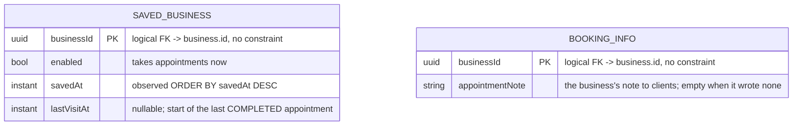

[← Local database ER diagrams](README.md)

# Appointments

Booked appointments, pending appointment requests, and a business's booking settings. Written by
`CommonAppointmentDataSource`, `CommonAppointmentRequestDataSource` and `CommonAppointmentSettingsDataSource`.

These tables have **no foreign key to `business`**. `businessId` is only indexed. Deleting a business row
does not cascade here, and the client/employee references are denormalized snapshot columns.

The entities and DAOs on this page live in `:database:schema`, and both `BusinessDatabase` and
`ClientDatabase` hold a copy (see [README](README.md)).

Appointment statuses are stored by name: `SCHEDULED`, `COMPLETED`, `CANCELLED`, `NO_SHOW` and
`UNRESOLVED`. The unresolved outcome round-trips through the existing text column without a schema
migration. It is displayed as a neutral status and offers no mutation actions.

```mermaid
erDiagram
    APPOINTMENT ||--o{ APPOINTMENT_SERVICE_SNAPSHOT : "includes (CASCADE)"
    APPOINTMENT ||--o{ APPOINTMENT_ADJUSTMENT_SERVICE : "price adjustment adds (CASCADE)"
    APPOINTMENT_REQUEST ||--o{ APPOINTMENT_REQUEST_SERVICE_SNAPSHOT : "includes (CASCADE)"
    APPOINTMENT_SETTINGS ||--o{ APPOINTMENT_SETTINGS_DAY_SCHEDULE : "has (CASCADE)"
    APPOINTMENT_SETTINGS ||--o{ APPOINTMENT_SETTINGS_WORKING_TIME : "has (CASCADE)"
    APPOINTMENT_SETTINGS ||--o{ APPOINTMENT_SETTINGS_DAY_OFF : "has (CASCADE)"

    APPOINTMENT {
        uuid id PK
        uuid userId "logical FK -> backend user (creator)"
        uuid businessId "indexed; logical FK -> business.id, no constraint"
        uuid employeeId "default 000..0; logical FK -> employee.id"
        uuid employeeUserId "default 000..0"
        string employeeFullName "default ''; snapshot"
        instant date "range-queried per local day"
        string status "AppointmentStatus.name, incl. UNRESOLVED"
        string note
        string cancellationReason
        uuid clientId "logical FK -> client.id"
        string clientFullName "snapshot"
        string clientPhone "nullable; snapshot"
        string clientEmail "nullable; snapshot"
        uuid clientUserId "nullable; linked backend user, snapshot"
        string completedBy "nullable; AppointmentCompletedBy.name"
        string adjustedPriceCurrency "nullable; set iff a price adjustment exists"
        long adjustedPriceValue "nullable"
        string priceAdjustmentReason "nullable"
        string clientNote "default ''; the client's note from the request"
    }

    APPOINTMENT_SERVICE_SNAPSHOT {
        uuid appointmentId PK,FK
        uuid id PK "logical FK -> service.id"
        string name
        uuid groupId
        string priceCurrency
        long priceValue
        duration duration
        int count "default 1; booked quantity, expanded to repeated snapshots in the domain"
    }

    APPOINTMENT_ADJUSTMENT_SERVICE {
        uuid appointmentId PK,FK
        int position PK "order in PriceAdjustment.additionalServices"
        uuid id "logical FK -> service.id"
        string name
        uuid groupId
        string priceCurrency
        long priceValue
        duration duration
    }

    APPOINTMENT_REQUEST {
        uuid id PK
        uuid userId
        uuid businessId "indexed; no constraint"
        uuid employeeId "default 000..0"
        uuid employeeUserId "default 000..0"
        string employeeFullName "default ''"
        string status "AppointmentRequestStatus.name"
        instant date
        string note
        string declineReason
        uuid clientId
        string clientFullName
        string clientPhone "nullable"
        string clientEmail "nullable"
        uuid clientUserId "nullable; linked backend user, snapshot"
    }

    APPOINTMENT_REQUEST_SERVICE_SNAPSHOT {
        uuid requestId PK,FK
        uuid id PK
        string name
        uuid groupId
        string priceCurrency
        long priceValue
        duration duration
    }

    APPOINTMENT_SETTINGS {
        uuid id PK
        uuid businessId UK "one settings row per business"
        string timeZone
        bool automaticApproval
        int inBetweenBreakInMinutes
        string appointmentNote
        bool permissionView "current user's APPOINTMENTS grant; default 0"
        bool permissionUpdate
        bool permissionDelete
        bool automaticCompletion "default 1"
    }

    APPOINTMENT_SETTINGS_DAY_SCHEDULE {
        uuid settingsId PK,FK
        string dayOfWeek PK
        bool isActive
    }

    APPOINTMENT_SETTINGS_WORKING_TIME {
        uuid settingsId PK,FK
        string dayOfWeek PK
        string from PK
        string to PK
    }

    APPOINTMENT_SETTINGS_DAY_OFF {
        uuid settingsId PK,FK
        string start PK
        string end PK
    }
```

- **Per-day window.** `appointment` is queried by `[startOfDay, startOfNextDay)` computed in
  `TimeZone.currentSystemDefault()`, which is the *device* zone and not the business `timeZone`. Stale-row
  deletion in [Get appointments for business](../operations/appointments/get-appointments-for-business.md)
  covers only that window. The sync marker is per date:
  `appointments_prefs` / `last_synced_at_<businessId>_<yyyy-MM-dd>`.
- **History shares the table.** [Get appointment history](../operations/appointments/get-appointment-history.md)
  saves its pages into `appointment` and, without a search, deletes only the cached rows of the business within
  each page's dates (`getIdsBetween`), so the per-day lists and the history never remove each other's rows outside
  the range a response covers. `flow()` reads them with `observeForBusiness` (`order by date desc, id desc`).
- **Only requests assigned to the signed-in user are stored**, fetched page by page from
  `/request/history/{businessId}?employeeId=<own>&status=PENDING&order=SOONEST_FIRST`. `refresh()` of [Get assigned
  appointment requests](../operations/appointments/get-assigned-appointment-requests.md) replaces the cached rows with
  the first page and `loadMore()` adds the next one; `flow()` filters to `PENDING` and sorts by `date`. Sync marker:
  `appointment_requests_prefs` / `last_synced_at_<businessId>`. The cursor of the next page is not stored: the
  screen's `ListPager` keeps it in memory.
- **Repeated services.** The backend stores one `ServiceSnapshot` per booked count. Locally they collapse into one
  `appointment_service_snapshot` row per service id with a `count` (its PK is `(appointmentId, id)`), and
  `AppointmentLocal.toDomain()` expands it again. Without `count`, a service booked twice would come back once,
  and a reschedule built from the cached row would drop the extra booking on the server.
- **Client's note.** `clientNote` holds the note the client wrote on the request the appointment came from (wire
  field 13). The client-facing `GET /api/appointments/upcoming` blanks the business's own `note` and sends only this
  one, which the client web app shows as "Your note" on Booking details. Added by `AutoMigration(27, 28)` in
  `BusinessDatabase` and `AutoMigration(6, 7)` in `ClientDatabase` (an additive column, default `''`).
- **Price adjustment** is spread over the nullable `adjusted*`/`priceAdjustmentReason` columns plus
  `appointment_adjustment_service` (ordered by `position`). `adjustedPriceValue`/`adjustedPriceCurrency` being
  non-null is what marks an adjustment as present.
- **Writes:** list refreshes, [Get appointment](../operations/appointments/get-appointment.md)
  `refresh(id)`, [Create appointment](../operations/appointments/create-appointment.md),
  [Approve request](../operations/appointments/approve-appointment-request.md),
  [Update appointment](../operations/appointments/update-appointment.md),
  [Cancel appointment](../operations/appointments/cancel-appointment.md),
  [Complete appointment](../operations/appointments/complete-appointment.md) and
  [Mark appointment as no-show](../operations/appointments/mark-appointment-no-show.md)
  (`upsertWithServices` for one row, which also replaces the adjustment services). Every one of these saves the
  server result in a separate datasource call after the network call, so `AppointmentListViewModel` redraws from
  the table.
  [Approve request](../operations/appointments/approve-appointment-request.md) and
  [Decline request](../operations/appointments/decline-appointment-request.md) also delete the handled
  `appointment_request` row (`deleteByIds`), so request `flow()` subscribers drop it at once. In the client web app,
  [Withdraw appointment request](../operations/appointments/withdraw-appointment-request.md) instead sets the
  client's withdrawn request to `CANCELLED` (`updateStatus`), so its details screen shows it closed; upcoming
  refreshes only delete stale `PENDING` rows, so it stays cached until logout.
  [Get appointment](../operations/appointments/get-appointment.md) `invoke(id)` reads only from the
  database (`getById` is non-nullable). Its `refresh(id)` fetches one appointment and saves the returned
  aggregate with the same `upsertWithServices` path. Failed reads do not overwrite the cache; no per-day
  sync marker is advanced by a single-record refresh.
- **Settings** are written by [Get appointment settings](../operations/appointments/get-appointment-settings.md)
  `refresh()` and [Update appointment settings](../operations/appointments/update-appointment-settings.md). They have no sync marker, because
  a `null` row is itself unambiguous.
- **Client web app.** In `ClientDatabase`, `appointment` and `appointment_request` hold only the signed-in client's
  own upcoming bookings, written by [Get upcoming bookings](../operations/appointments/get-upcoming-bookings.md)
  (`CommonClientBookingDataSource`). Its refresh deletes cached `SCHEDULED` appointments and `PENDING` requests the
  response no longer returns (`getScheduledIds`/`getPendingIds`) and upserts the rest; `observeScheduled` and
  `observePending` read them back by `date`. These queries are not scoped by business, so they are used only on the
  web. `appointment_request_service_snapshot` has no `count` column, so a request with a repeated service is cached
  with that service once.
- Cleared on logout: yes, all of them.

## Client web app tables (`ClientDatabase` only)

Written by `CommonClientBookingDataSource` through `SavedBusinessDao` and `BookingInfoDao` (both in `ClientDaos`, so
`BusinessDatabase` does not hold them). No foreign keys: the business they refer to is read separately into `business` by
[Get businesses](../operations/business/get-businesses.md) and may be missing locally.

- **`saved_business`** is replaced as a whole by [Get saved businesses](../operations/appointments/get-saved-businesses.md)
  `refresh()` (`replaceAll`: clear + upsert in one transaction), also run by
  [Save business](../operations/appointments/save-business.md).
- No sync marker: the Home screen treats an empty emission as "not loaded yet" until its first refresh finishes.
- Cleared on logout: yes (`savedBusinessDao.clear()`).
- **`booking_info`** holds one row per business a client opened the Review step of, upserted by
  [Get booking info](../operations/appointments/get-booking-info.md) `refresh()`
  (`GET /api/appointments/booking-info/{businessId}`) and deleted for that business when the backend answers 404
  (it no longer takes appointments). `flow()` observes the business's row, `null` until the first refresh.
- No sync marker: a single row per business, so a missing row already means "not loaded yet".
- Cleared on logout: yes (`bookingInfoDao.clear()`).
