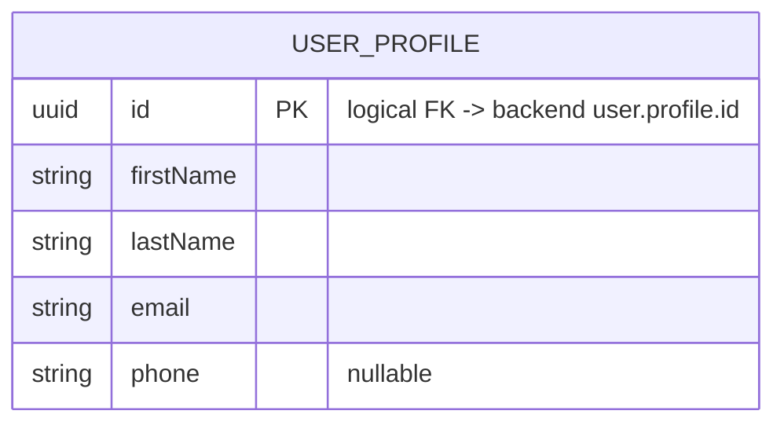

[← Local database ER diagrams](README.md)

# Authorization

The signed-in user's own profile. There is at most one row, because the DAO reads with `limit 1`.
Written by `CommonUserProfileDataSource` and read through `UserProfileCRUD`
([diagram](../operations/authorization/user-profile-crud.md)).

- Written by: `UserProfileCRUD.updateFromRemote()` (via [initial app data fetch](../operations/authorization/initial-app-data-fetch.md)),
  `UserProfileCRUD.get()` on a cache miss, `UserProfileCRUD.update()` ([Edit profile](../operations/settings/edit-profile.md)),
  `ConfirmEmailChange` (only the `email` column of an already cached row, [Confirm email change](../operations/authorization/confirm-email-change.md)).
- Read by: [Create appointment](../operations/appointments/create-appointment.md) (the current user becomes
  the assigned employee), [Delete account](../operations/settings/delete-account.md) (the confirmation target), [Get settings](../operations/settings/get-settings.md), and
  [Get notification settings](../operations/settings/get-notification-settings.md) (the `flow()` is keyed on `id`).
- Cleared on logout: yes.

## Public signup legal documents

`CommonSignUpLegalDocumentsDataSource` owns the `signup_legal_documents_prefs` DataStore bucket. Its
`documents` string stores one JSON snapshot containing the privacy-policy version and URL plus the
terms-of-service version and URL. `GetSignUpLegalDocuments.refresh()` writes only a complete pair;
`GetSignUpLegalDocuments.invoke()` reads it without networking. Each save replaces the whole pair atomically.
The datasource is registered as a singleton and opens its bucket once. The snapshot survives app restarts.
The snapshot is intentionally retained across logout so signup can read the public documents immediately.
This is an explicit exception to the usual clearing of new persisted caches. It stores document metadata,
not user consent. No Room table or migration is involved.
