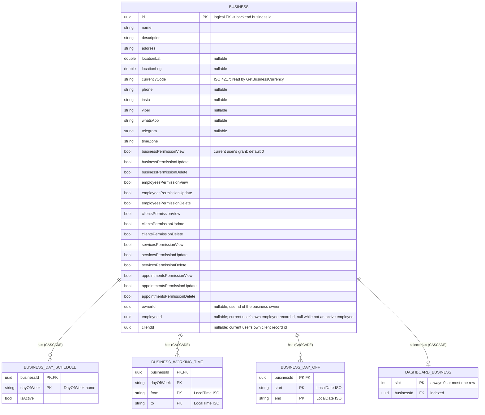

[← Local database ER diagrams](README.md)

# Business

Every business the user owns or works at, including the requesting user's permission grants for each one.
Written by `CommonBusinessDataSource`. The currently selected ("dashboard") business is the single row of
`dashboard_business`. It has a `CASCADE` foreign key to `business`, so it can only point at a cached business
and disappears when that business is deleted.

`business` is the root of most foreign keys in the database. Deleting a business row cascades to its
schedule tables and to `client`, `employee`, `employee_invitation`, `service` and `service_group`
(see [overview](overview.md)).

- Written by: [Refresh business info](../operations/business/refresh-business-info.md) (`upsertAllWithChildren`
  for the whole list) and [Update business](../operations/business/update-business.md) (`upsertWithChildren` for one).
- Read by: [Observe dashboard business changes](../operations/business/observe-dashboard-business-changes.md)
  (which many features use to scope their lists), [Observe user businesses
  changes](../operations/business/observe-user-businesses-changes.md), [Update business](../operations/business/update-business.md)
  (reads the current row before merging the edit), [Get business currency](../operations/services/get-business-currency.md)
  and [Is business owner](../operations/employees/is-business-owner.md) (compares `ownerId` with an employee's `userId`).
  `employeeId` is read by [Observe dashboard business](../operations/business/observe-dashboard-business-changes.md)
  (`ObserveCurrentBusiness` in appointments, which scopes the appointment list to the caller) and by
  [Create appointment](../operations/appointments/create-appointment.md). `clientId` is stored but not read yet.
- Cleared on logout: yes (`businessDao.clear()`).
- Deleted by: [Refresh business info](../operations/business/refresh-business-info.md) removes local businesses
  missing from `GET /api/business/mine` (`businessDao.deleteByIds`), cascading to their clients, employees,
  invitations, service groups and services.
- `dashboard_business` is written by [Switch dashboard business](../operations/business/switch-dashboard-business.md)
  (`setDashboardBusiness`: upsert, or delete for `null`) and by [Refresh business
  info](../operations/business/refresh-business-info.md) with `applyDashboardIdFromRemote = true` or
  `refreshAndSelect` (`upsertAllWithChildrenAndDashboard`, which writes the list and the selection in one
  transaction). It is read by [Observe dashboard business changes](../operations/business/observe-dashboard-business-changes.md)
  (`observeDashboardBusinessId`, `distinctUntilChanged`) and, joined to every `business` row as an `isDashboard`
  flag in one query (`observeAllBusinessesWithDashboardFlag`), by [Observe dashboard setup
  status](../operations/business/observe-dashboard-setup-status.md). Cleared on logout (`clearDashboardBusiness()`, and by
  cascade from `businessDao.clear()`).
- Migration notes: 15 → 16 added the nullable `business.ownerId` column (auto-migration). Rows cached before
  the migration keep `NULL` until the next [Refresh business info](../operations/business/refresh-business-info.md).
  18 → 19 added the nullable `business.employeeId` and `business.clientId` columns (auto-migration), with the same
  `NULL`-until-refresh behaviour: until then the appointment list is empty and creating an appointment fails with
  `NotAnEmployee`. 19 → 20 added the `dashboard_business` table (auto-migration) and moved the selection there
  from the `business_prefs` DataStore bucket. The old value is not migrated: after the update the selection is
  empty until the user picks a business (or signs in again, which applies the server's selection).
