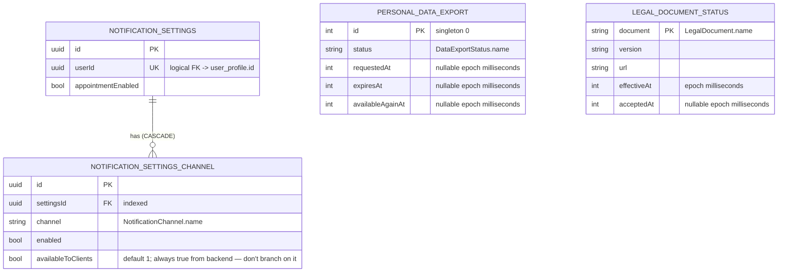

[← Local database ER diagrams](README.md)

# Settings

The user's notification preferences: one settings row per user plus one row per delivery channel.
Written by `CommonNotificationSettingsDataSource`. The color scheme and the pending push token are
key-value data in DataStore, not tables (see [preferences](preferences.md)).

Legal-document acceptance statuses live in the `legal_document_status` Room table, owned by
`CommonLegalDocumentsDataSource`. Each document has explicit version, URL, effective-time and nullable
acceptance-time columns. `GetLegalDocumentStatuses.refresh()` replaces the list in one DAO transaction;
`flow()` observes that table directly and emits an empty list when there are no rows. Never-fetched and
successfully fetched empty results intentionally have the same presentation: two unknown-status rows.
There is no sync marker or preferences bucket for legal-document statuses. Failed network reads
preserve cached rows. Logout clears the table through the existing `LogOutAction` binding.
The table is scoped to the current account by logout cleanup and has no user-profile FK.
Public signup legal metadata remains in its separate bucket.

- `availableToClients` is always `true` on the wire. Whether a channel is shown must be decided by whether
  it is **present in the list**, not by this column.
- Written by: [Get notification settings](../operations/settings/get-notification-settings.md) `refresh()`
  and [Update notification settings](../operations/settings/update-notification-settings.md) (`upsertWithChildren`).
- Read by: `GetNotificationSettings.flow()`, keyed on the `user_profile` id, so the flow emits `null` until a
  profile row exists.
- Cleared on logout: yes (`notificationSettingsDao.clear()`).

- Legal statuses are written by [Get legal document statuses](../operations/settings/get-legal-document-statuses.md)
  using `LegalDocumentStatusDao.replaceAll()`: delete stale records and upsert the received list in one
  transaction, with no intermediate empty emission. Reads use `observeAll()` ordered by document type.
- Added in schema 24 by `AutoMigration(23, 24)`. Domain ↔ entity mapping stays in the feature data module;
  the database module has no feature-domain dependency.
- Legal status logout cleanup: `legalDocumentStatusDao.clear()`.

Personal data export status and timestamps live in the singleton `personal_data_export` Room row,
owned by `CommonDataExportDataSource`. `PersonalDataExportDao.observe()` emits a nullable row at key
`0`; `GetPersonalDataExport.flow()` maps a record whose known expiry is at or before now (injected
clock) to null without writing. A missing row also emits null. Unexpired records and records with no
expiry pass through unchanged. The export screen refreshes from the server on open only when the first
observed value is null (missing or expired) or RUNNING; that refresh also removes an expired file
once the server confirms it.

`GetPersonalDataExport.refresh()` and successful `StartPersonalDataExport` calls fetch from the network,
then call the separate `saveInDb()` write. The database observer alone renders status; neither network
return value is rendered directly. Writes upsert key `0` and retain all observation emissions, including
unchanged snapshots needed to reconcile retry UI. Network failures preserve the cached row. Logout
clears the table through `CommonDataExportDataSource` bound as datasource and `LogOutAction`. There is
no user-profile FK or preferences marker. Schema 25 adds this table with `AutoMigration(24, 25)`;
existing tables and rows are preserved. Domain mapping stays in the settings data module.

The JSON export payload is stored as one UTF-8 file at
`personal_data_exports/<requestedAt>-<expiresAt>/bookk-personal-data.json` in the app cache (epoch
milliseconds), not in Room or preferences. `DownloadPersonalDataExport` reuses the file matching the
current READY export or downloads and saves JSON through separate datasource calls; `saveFile()`
clears the directory first, so only one export is kept. The cache survives screen recreation; OS
eviction causes a download on the next action. New export requests, refreshes returning a status that
is not READY or already expired, and logout clear the directory. On every app start,
`DeleteExpiredPersonalDataExportFile` (from `InitialAppDataFetch.timestampProtectedFetch`) also clears it
unless the cached row is READY and unexpired, so an expired file does not wait for the screen to reopen. Atomic file replacement prevents
partially written JSON from being reused. All filesystem access goes through `FileProvider`
(`exists`, atomic `writeText`, `deleteRecursively`), implemented once in `CommonFileProvider`.

The native share sheet opens this cached file directly; no temporary copies are made. Android exposes
only `cache/personal_data_exports/` through the settings presentation module's non-exported
`FileProvider`. Files explicitly saved or shared outside the app remain under the user's control. No
Room schema or preference keys are added for downloaded files.
