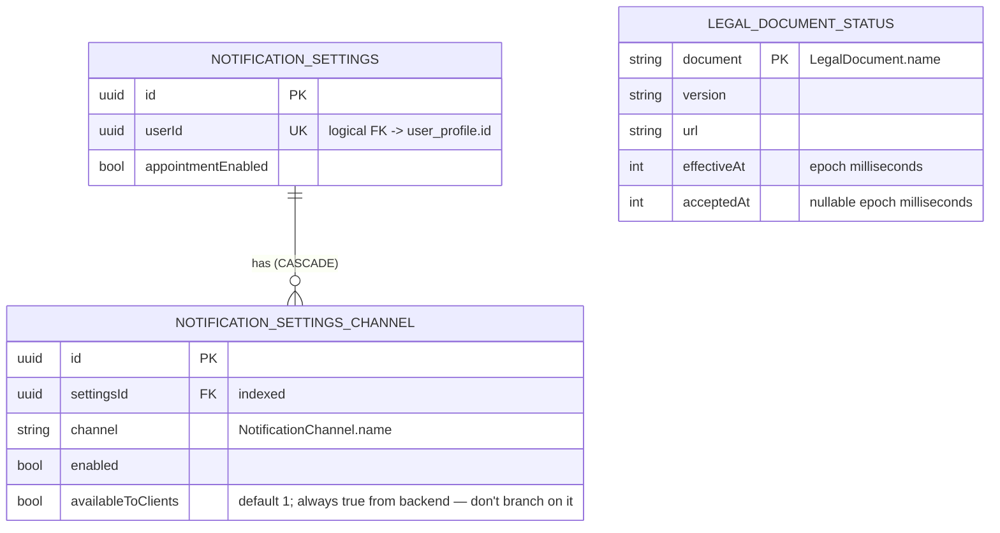

[← Local database ER diagrams](README.md)

# Settings

The user's notification preferences: one settings row per user plus one row per delivery channel.
Written by `CommonNotificationSettingsDataSource`. The color scheme and the pending push token are
key-value data in DataStore, not tables (see [preferences](preferences.md)).

Legal-document acceptance statuses live in the `legal_document_status` Room table, owned by
`CommonLegalDocumentsDataSource`. Each document has explicit version, URL, effective-time and nullable
acceptance-time columns. `GetLegalDocumentStatuses.refresh()` replaces the list in one DAO transaction;
`flow()` observes that table directly and emits an empty list when there are no rows. Never-fetched and
successfully fetched empty results intentionally have the same presentation: two unknown-status rows.
There is no sync marker or preferences bucket for legal-document statuses. Failed network reads
preserve cached rows. Logout clears the table through the existing `LogOutAction` binding.
The table is scoped to the current account by logout cleanup and has no user-profile FK.
Public signup legal metadata remains in its separate bucket.

- `availableToClients` is always `true` on the wire. Whether a channel is shown must be decided by whether
  it is **present in the list**, not by this column.
- Written by: [Get notification settings](../operations/settings/get-notification-settings.md) `refresh()`
  and [Update notification settings](../operations/settings/update-notification-settings.md) (`upsertWithChildren`).
- Read by: `GetNotificationSettings.flow()`, keyed on the `user_profile` id, so the flow emits `null` until a
  profile row exists.
- Cleared on logout: yes (`notificationSettingsDao.clear()`).

- Legal statuses are written by [Get legal document statuses](../operations/settings/get-legal-document-statuses.md)
  using `LegalDocumentStatusDao.replaceAll()`: delete stale records and upsert the received list in one
  transaction, with no intermediate empty emission. Reads use `observeAll()` ordered by document type.
- Added in schema 24 by `AutoMigration(23, 24)`. Domain ↔ entity mapping stays in the feature data module;
  the database module has no feature-domain dependency.
- Legal status logout cleanup: `legalDocumentStatusDao.clear()`.
