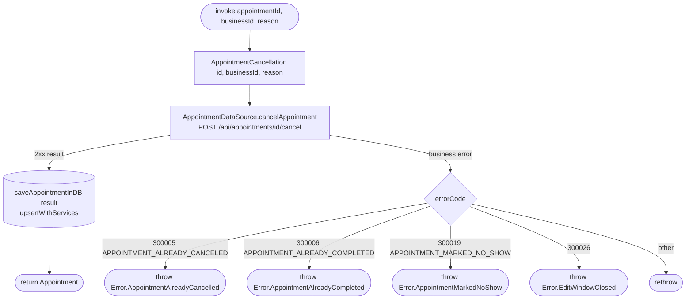

[← Operations](../README.md)

# Cancel appointment

`CancelAppointment(appointmentId, businessId, reason)` → `POST /api/appointments/{id}/cancel`
· called from `AppointmentDetailsViewModel`

The network call and the DB write are separate datasource methods, and the use case runs them in order. The
server result is saved with `upsertWithServices`, the same as in [Complete appointment](complete-appointment.md).

`EditWindowClosed` means the appointment ended more than seven days ago.

The details screen uses `Appointment.canBeCancelled(now)` to show Cancel only for `SCHEDULED`
appointments through seven days after their scheduled end, inclusive. On `EditWindowClosed`, it
shows a short error global message and calls `GetAppointment.refresh(id)` to update the cached
appointment and action visibility. Cancellation is not retried, and refresh plays no success haptic.
