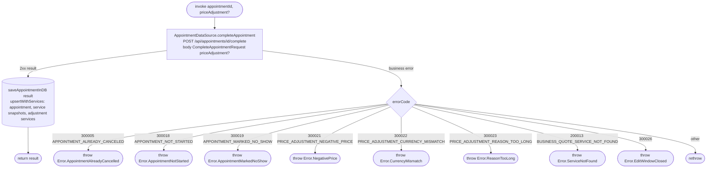

[← Operations](../README.md)

# Complete appointment

`CompleteAppointment(appointmentId, priceAdjustment = null)` → `POST /api/appointments/{id}/complete`
· called from `AppointmentDetailsViewModel` (the "Mark as completed" button)

Marks a **started** `SCHEDULED` appointment as `COMPLETED` with `completedBy = USER`. The backend treats an
already-completed appointment as a no-op and keeps its status and completer. The optional
`PriceAdjustmentDraft` (final charged price, extra catalog service ids, optional reason) is sent as
`CompleteAppointmentRequest.priceAdjustment` and replaces any earlier adjustment. The details screen
sends an entered adjustment, or `null` when the booked services and price are kept without a reason.

The network call and the DB write are separate datasource methods, and the use case runs them in order. The
server result is saved with `upsertWithServices`, which also rewrites the `appointment_adjustment_service` rows.

The details screen shows the button only when `Appointment.canBeCompleted(now, timeZone)` is true: `SCHEDULED`,
`date <= now`, and no more than `Appointment.EDIT_WINDOW` (seven days) after the scheduled end. The scheduled end is the start
plus all booked service durations; the exact edit-window cutoff is inclusive. The ViewModel passes
its injected clock's instant and the device time zone (the zone appointment dates are mapped in)
when rendering action visibility.

`EditWindowClosed` means the appointment ended more than seven days ago.

On this error, the details ViewModel closes the completion sheet, shows a short error global message
and calls `GetAppointment.refresh(id)` to update the cached appointment and action visibility.
Completion is not retried, and refresh plays no success haptic.
