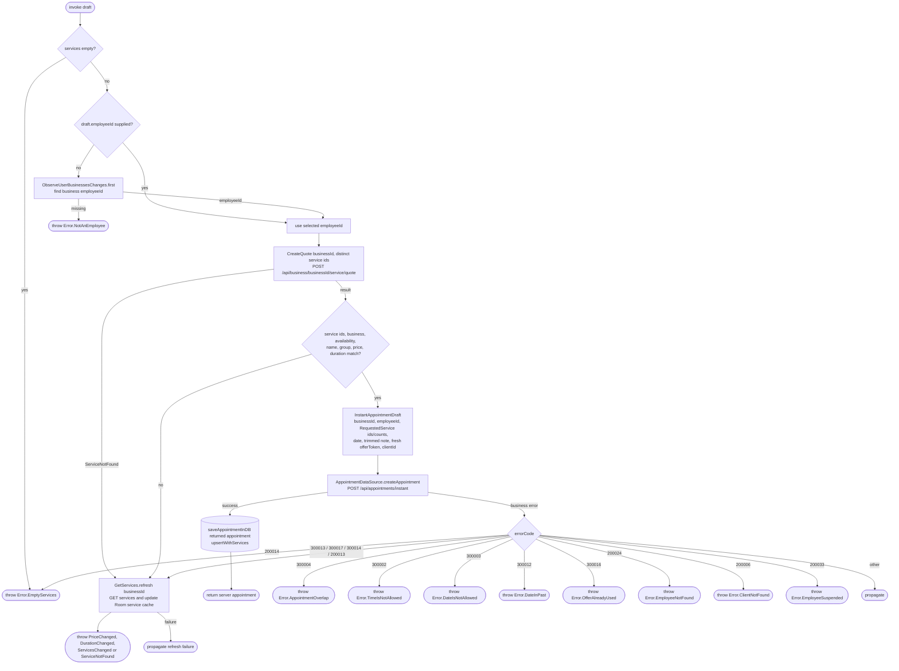

[← Operations](../README.md)

# Create appointment with a fresh quote

`CreateAppointment(draft)` → quote and validation → `POST /api/appointments/instant`.
The caller supplies displayed service snapshots and may select `employeeId`; when omitted, the cached
business's caller employee id is used. No client-generated appointment id or initiator snapshot is sent.

Duplicate service selections become positive counts; the quote requests each id once. Quote mismatches
and quote-related booking races refresh backend services before returning the mismatch error. If that
refresh fails, its error propagates and booking is not retried. A refreshed quote never silently accepts
changed booking details. A fresh request from the caller is required after reviewing updates.

The creation screen observes the local service cache through `ObserveAppointmentOptions`. Each
emission replaces selected service snapshots by id, removes selections missing from the options,
and recalculates the subtotal and Create availability. The client, date, time and note are preserved.
Option changes keep Create disabled while a booking is pending. Quote rejection explains that the
employee must review the updated form; the ViewModel never automatically retries the booking.

Composes `CreateQuote`, `GetServices.refresh` on mismatch, and `ObserveUserBusinessesChanges` for the
default employee. Quote retrieval and cache refresh are use-case orchestration, never combined in a datasource.
