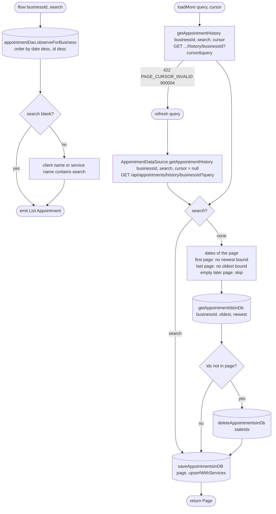

[← Operations](../README.md)

# Get appointment history (paged)

`GetAppointmentHistory.flow(businessId, search)` / `.refresh(AppointmentHistoryQuery)` /
`.loadMore(AppointmentHistoryQuery, cursor)` → `GET /api/appointments/history/{businessId}[?cursor=][&query=]`
· called from `AppointmentHistoryViewModel` (through its `ListPager`)

`GetAppointmentHistory` is a `PagedSource<AppointmentHistoryQuery, Appointment>`:
`AppointmentHistoryQuery(businessId, search)`. The route returns one `AppointmentPage` (`data` field 1,
`nextCursor` field 3, default 50 appointments), newest first by start, and the server finds a `query` in the
client's whole name (ignoring case) or in part of a service name. The pages are cached in the same `appointment`
table the per-day lists use ([Get appointments for business](get-appointments-for-business.md)), and the screen
renders only `flow()`.

- **Without a search** each page replaces the cached appointments of the business within its own dates and keeps
  the rest, so rows the day lists cached outside them stay: the first page covers everything from its oldest
  appointment upwards, a later page its own first to last appointment, and the last page also everything older.
  An empty first and last page (no history) removes every cached appointment of the business; an empty later page
  removes nothing.
- **With a search** the found appointments are only added to the cache.
- `loadMore` reads the page after the given cursor for the same query. A rejected cursor (`PAGE_CURSOR_INVALID`
  900004) restarts from the first page through `refresh`.
- `flow(search)` emits the cached appointments of the business, `order by date desc, id desc`, filtered on the
  device when a search is given: the client's full name or the name of a booked or provided service contains it
  (ignoring case). That matches at least what the server's `query` matches, so its results always show, while
  typing and offline it filters what is cached.

The use case keeps no paging state; the cursor and query of the next page live in the screen's `ListPager`.

