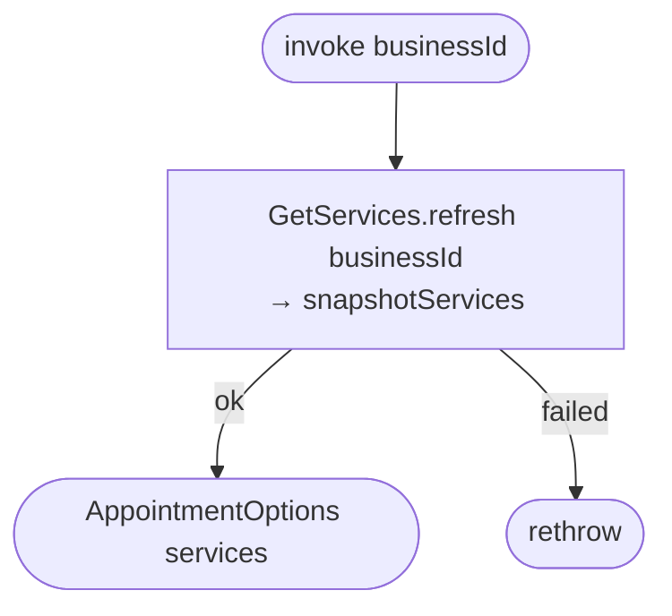

[← Operations](../README.md)

# Get appointment options

`GetAppointmentOptions(businessId)` → `GetServices.refresh(businessId)`
· called from `AppointmentCreateViewModel` on start and `AppointmentDetailsViewModel` (service options)

Refreshes the services the appointment forms offer and maps them down to the snapshot type an appointment stores.
The refresh rewrites the services cache, so [Observe appointment options](observe-appointment-options.md)
re-emits the fresh list; the screens render from that flow, not from this result. Clients are no longer part of
the options: the create form picks a client on the clients feature's paged "Select client" screen and reads the
picked one with [Get client snapshot](get-client-snapshot.md).

Composes [Get services](../services/get-services.md).
