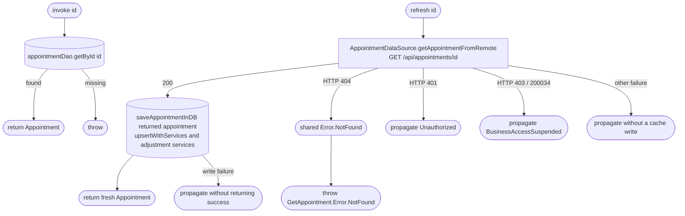

[← Operations](../README.md)

# Get appointment

`GetAppointment(id)` → local read, `appointmentDao.getById(id)`
`GetAppointment.refresh(id)` → `GET /api/appointments/{id}` → cache the returned aggregate
· called from `AppointmentDetailsViewModel`

Opening details reads the cached appointment and its service snapshots from Room. This local read has
no network fallback; `getById` is non-null and throws when the row is absent. Recovery after a mutation
conflict or closed edit window explicitly calls `refresh(id)` to get current server details, including
an appointment moved to a different date. The network fetch and cache write are separate datasource
methods orchestrated by this use case.

The endpoint requires the business's appointments view grant. HTTP 404 has a plain-text body and
means either the appointment is missing or the caller no longer has that grant. The shared HTTP
mapper represents that response as the shared `me.bookk.core.domain.entity.Error.NotFound`;
`refresh` maps that typed error to `GetAppointment.Error.NotFound` without inspecting HTTP status codes.
Other errors propagate, including suspended access through the shared mapper. Failed reads do not
overwrite the cache, and a successful single-appointment refresh does not update a per-day sync marker.

The details ViewModel shows a short error global message before refreshing and renders the returned
appointment without a success haptic. A missing or inaccessible appointment closes details with an
unavailable global message. Other refresh failures use the normal notification mapper. A failed
mutation is never retried automatically.
