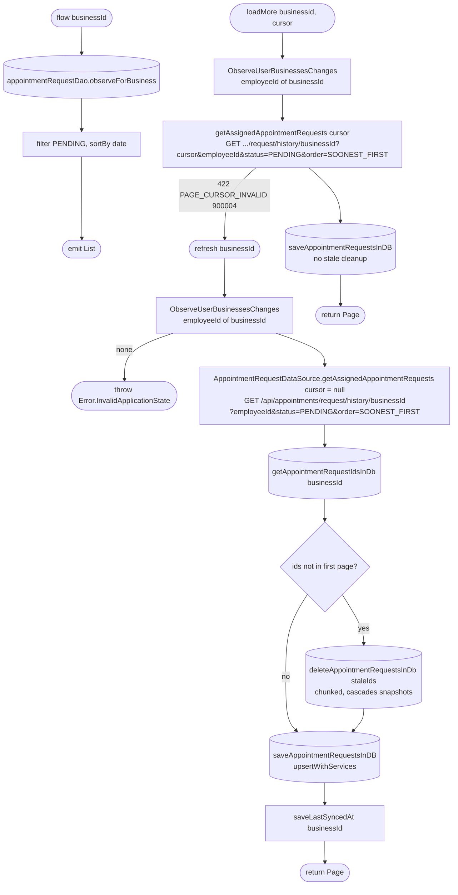

[← Operations](../README.md)

# Get assigned appointment requests

`GetAssignedAppointmentRequests.flow(businessId)` / `.refresh(businessId)` / `.loadMore(businessId, cursor)` (a
`PagedSource<Uuid, AppointmentRequest>` keyed by the business id) →
`GET /api/appointments/request/history/{businessId}?employeeId=&status=PENDING&order=SOONEST_FIRST[&cursor=]`
· called from `AppointmentListViewModel` (request count) and `AppointmentRequestViewModel` (requests list, paged)

The request history route returns one page (`AppointmentRequestPage`: `data`, `nextCursor`, default 50 rows) of the
business's requests. The filters ask for the `PENDING` ones the caller is booked to serve, earliest first: the
`employeeId` is the signed-in user's `Business.employeeId` from `ObserveUserBusinessesChanges`, and a dashboard
business without one is an `Error.InvalidApplicationState`. The route needs the appointments `view` permission
and answers 404 without it, which reaches the callers as a mapped error (`AppointmentListViewModel` ignores it,
`AppointmentRequestViewModel` shows it). `appointment_request` therefore only holds requests assigned to the
signed-in user, and the stale-row cleanup below cannot remove anything else. `flow()` still filters to `PENDING`
and sorts by `date`, so a row whose status changed locally drops out at once.

`refresh` reads the first page and replaces the cache with it, so rows of later pages loaded before are dropped
until the list scrolls to them again. `loadMore` reads the page after the given cursor and adds it to the cache.
The use case keeps no paging state: the cursor comes from the `ListPager` of the screen (designsystem
`convenience`, created with `listPager(listState, notifications, source)`), which keeps the business id it loaded
the first page for together with the `nextCursor` of the last page in memory, and offers the next page only while
there is one. The server rejecting the cursor (`PAGE_CURSOR_INVALID` 900004) restarts from the first page
through `refresh`, whose page carries the cursor the pager continues from (`fetchPageOrRestart` and `Page` in
`core/domain/pagination`).

