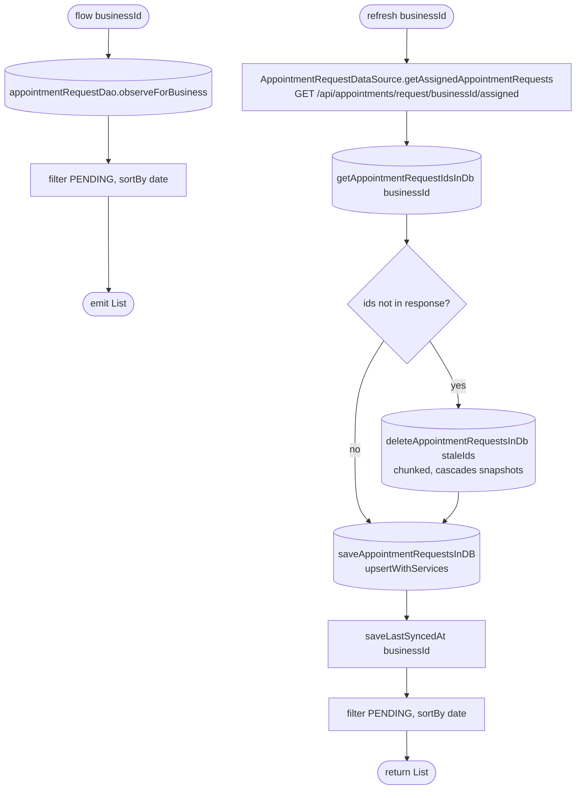

[← Operations](../README.md)

# Get assigned appointment requests

`GetAssignedAppointmentRequests.flow(businessId)` / `.refresh(businessId)` → `GET /api/appointments/request/{businessId}/assigned`
· called from `AppointmentListViewModel` (request count) and `AppointmentRequestViewModel` (requests list)

The route returns the `PENDING` requests in the business that the caller, as an employee, is booked to serve,
earliest first. It needs the appointments `view` permission and answers 404 without it, which reaches the
callers as a mapped error (`AppointmentListViewModel` ignores it, `AppointmentRequestViewModel` shows it). The
business-wide `GET /api/appointments/request/{businessId}` is not used by the app, so `appointment_request`
only ever holds requests assigned to the signed-in user and the stale-row cleanup below cannot remove anything
else. Both paths still filter to `PENDING` and sort by `date`, so a row whose status changed
locally drops out at once.

