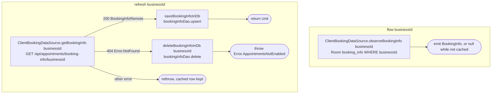

[← Operations](../README.md)

# Get booking info

`GetBookingInfo.flow(businessId)` / `GetBookingInfo.refresh(businessId)` → `GET /api/appointments/booking-info/{businessId}`
· called by booking's [Get business message](../booking/get-business-message.md) (client web app's Review step);
bound by `clientAppointmentsDomainModule()`

What a client needs to know before booking at a business, currently the note the business wrote for clients in its
appointment settings ("Note to clients" in the business app). Staff read that note through the appointment settings,
which clients may not read; this route answers any signed-in user. The response is `BookingInfo` (`businessId` #1,
`appointmentNote` #2, empty when the business wrote none; a missing note reads as empty).

`flow()` observes the business's cached row in `ClientDatabase`'s `booking_info` table and emits `null` until the first
refresh saves one. `refresh()` fetches the info and upserts it. A `404` means the business does not take appointments:
the cached row is deleted, so no stale note stays on screen, and `Error.AppointmentsNotEnabled` is thrown. Any other
failure leaves the cached row as it is.

