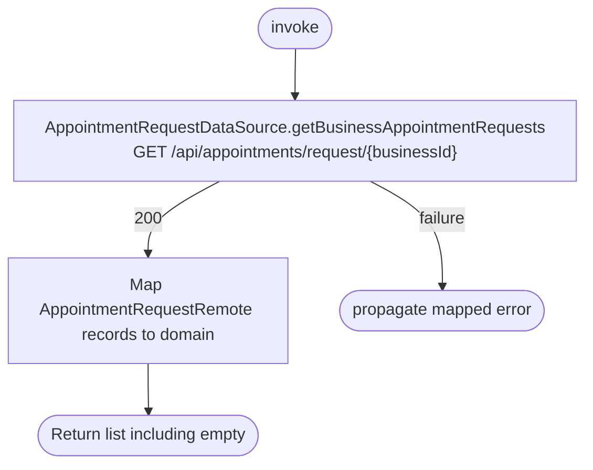

[← Operations](../README.md)

# Get business appointment requests

`GetBusinessAppointmentRequests.invoke()` → `GET /api/appointments/request/{businessId}`. No local cache is read or written.

Reads the business-wide list, separately from `/mine`. It does not overwrite the cache currently used
by `GetOwnAppointmentRequests`, so caller-owned and business-wide refreshes cannot remove each other's rows.
Suspended-caller error 200034 is handled by the shared HTTP mapper.
