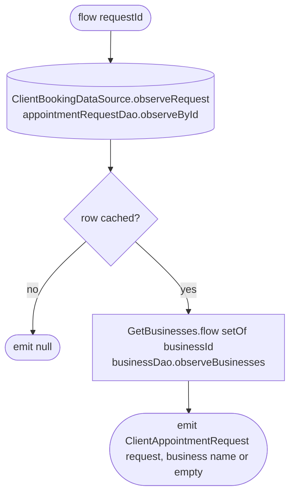

[← Operations](../README.md)

# Get client appointment request

`GetClientAppointmentRequest.flow(requestId)` → local only: Room `appointment_request` by id (any status) + [Get
businesses](../business/get-businesses.md) `flow`
· called by booking's [Get booking request details](../booking/get-booking-request-details.md); bound by
`clientAppointmentsDomainModule()` (client web app only)

Reads one of the client's own requests by id, whatever its status, so the request details screen works for every
list that caches requests (today the upcoming bookings; later the client's booking history). It is named after its
business through the cached `business` row (empty while that is not cached). It emits `null` while the request is
not cached, for example after an upcoming bookings refresh deleted a request the business answered meanwhile;
[Withdraw appointment request](withdraw-appointment-request.md) keeps the row and sets it to `CANCELLED`. There is
no `refresh()`: the backend has no client-readable route for one request (`GET /api/appointments/{id}` needs the
business's view grant), so the lists that fetch requests keep the rows current.

