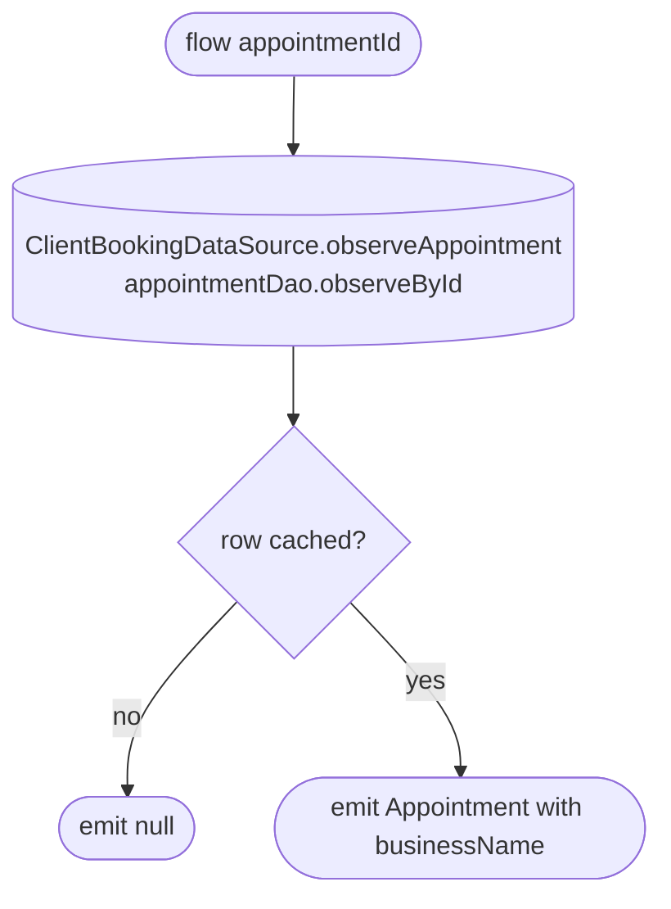

[← Operations](../README.md)

# Get client appointment

`GetClientAppointment.flow(appointmentId)` → local only: Room `appointment` by id (any status)
· called by booking's [Get booking appointment details](../booking/get-booking-appointment-details.md); bound by
`clientAppointmentsDomainModule()` (client web app only)

Reads one of the client's own appointments by id, whatever its status, so the appointment details screen works for
every list that caches appointments (Home's upcoming bookings and the Bookings screen). It carries its business's
name in `businessName` (the backend sends the business's current name with every appointment, stored in
`appointment.businessName`) and the client's note in `clientNote`. It emits `null` while the appointment is not cached. There is no `refresh()`: the backend has no
client-readable route for one appointment (`GET /api/appointments/{id}` needs the business's view grant), so the
lists that fetch appointments keep the rows current.

