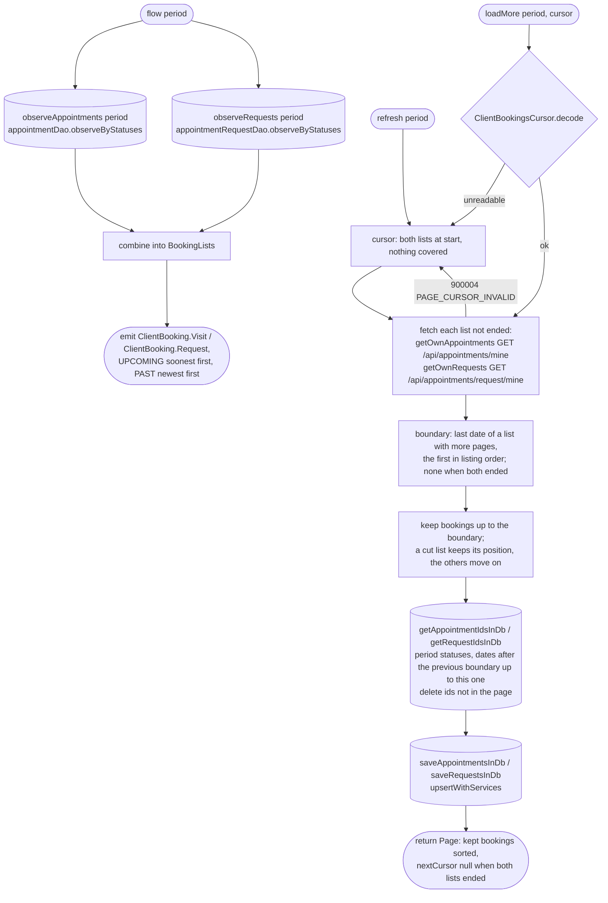

[← Operations](../README.md)

# Get client bookings

`GetClientBookings.flow(period)` / `.refresh(period)` / `.loadMore(period, cursor)` → `GET /api/appointments/mine`
and `GET /api/appointments/request/mine`
· wrapped by booking's [Get bookings](../booking/get-bookings.md), the Bookings screen of the client web app; bound
by `clientAppointmentsDomainModule()`

Client-facing: all of the caller's bookings across every business, in two periods. The backend pages appointments and
requests by separate routes, each with its own opaque `nextCursor` (default page of 50):

| Period | Appointments (`/mine`) | Requests (`/request/mine`) | Order |
|---|---|---|---|
| `UPCOMING` | `period=UPCOMING&status=SCHEDULED` (not ended yet) | `period=UPCOMING&status=PENDING` (not started yet) | soonest first |
| `PAST` | `status=COMPLETED,CANCELLED,NO_SHOW,UNRESOLVED`, any date | `status=DECLINED,CANCELLED`, any date | newest first |

The past period goes by status rather than `period=PAST`, so a cancelled future appointment or a declined
request for next week is listed there rather than in neither. Approved requests are left out: each is listed as
the appointment it became. A booking that ended but is not yet marked by the backend's jobs (appointments every
5 minutes, outdated requests cancelled every hour) is briefly in neither period.

**Merging two paged lists.** One page of `GetClientBookings` fetches the next page of each list that has not ended,
then cuts both at the **boundary**: the last date of a list that still has more pages (the earlier one in listing
order when both do). Bookings listed after the boundary are held back: not saved or returned, and that list's
position stays where it was, so its page is fetched again next time. The list that set the boundary always moves on,
so every page makes progress; once neither list has more pages nothing is cut. This keeps the cache gap-free, so a
booking never appears above ones already on screen when the next page arrives. The `ListPager` keeps one opaque
cursor for both: `ClientBookingsCursor` encodes each list's position (start, a backend cursor, or ended) and the
boundary covered so far. A cursor the backend rejects (`PAGE_CURSOR_INVALID`, 900004) or one that cannot be read
restarts from the first page.

**Cache.** Pages go into the shared `appointment` and `appointment_request` tables of `ClientDatabase` (which on the
web hold only the client's own bookings). Each page replaces the dates it covers, from just after the previous
boundary (or open on the first page) up to its own boundary (or open when both lists ended): cached bookings of the
period's statuses in those dates that the page does not contain are deleted. `flow(period)` reads both tables by the
period's statuses and sorts the merged list (the request's date compared with the appointment's in the device time
zone). Each booking carries its business's current name (`businessName`, sent with every appointment and request and
stored with the row), so no business is fetched.

