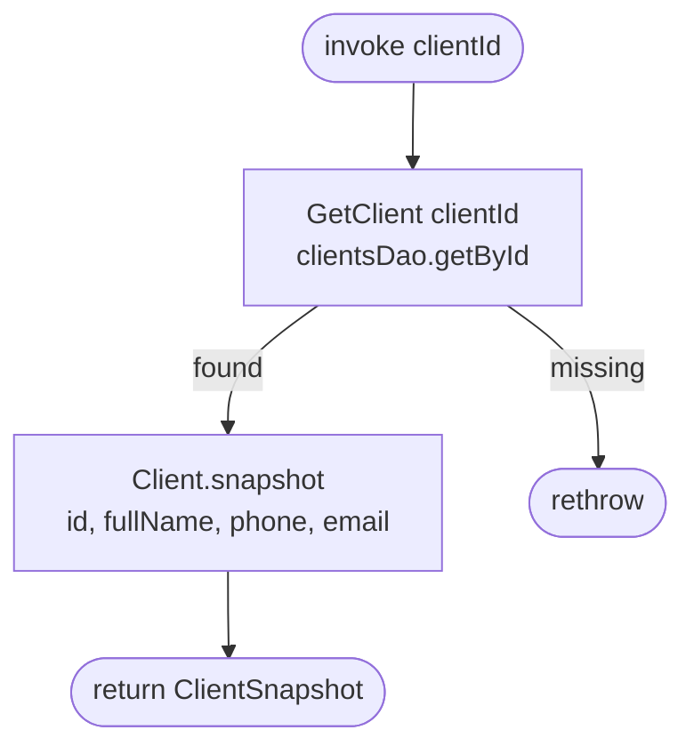

[← Operations](../README.md)

# Get client snapshot

`GetClientSnapshot(clientId)` → `GetClient(clientId)`, **local only**
· called from `AppointmentCreateViewModel` when a client is picked on the clients feature's "Select client" screen

Appointments' wrapper over the clients feature's [Get client](../clients/get-client.md), so the appointments
presentation never depends on the clients domain. The picked client is already cached: the select screen lists
only rows of `client`, and a client added from its "+" action ([Create client](../clients/create-client.md),
shown for users who may edit clients) is saved to `client` before it is returned as the pick, so this reads Room and maps the client to the `ClientSnapshot` an appointment draft
stores (`id`, `fullName`, `phone`, `email`). A client missing from the cache makes `GetClient` throw, and the error
reaches the screen as a notification while the form keeps no client.

Composes [Get client](../clients/get-client.md).
