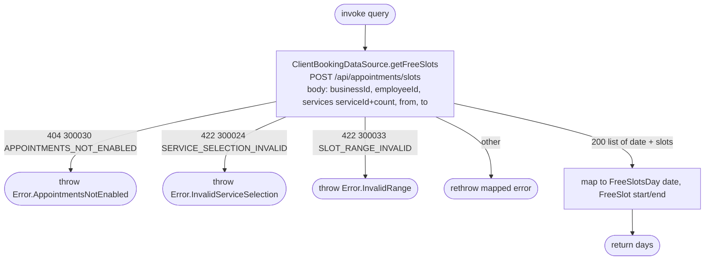

[← Operations](../README.md)

# Get free slots

`GetFreeSlots(query)` → `POST /api/appointments/slots` (backend nocturneproperties/bookkme#192) · called from
booking's [Get booking slots](../booking/get-booking-slots.md); bound by `clientAppointmentsDomainModule()`

Asks the backend which start times an employee can still be booked at for the given services (each with its count)
on every date from `from` to `to` (inclusive, dates in the business time zone). The response holds one entry per
date, in order, with its free slots (`start`, `end` instants) soonest first; a date with nothing free has an empty
list. The backend works the slots out from the business and employee schedules, day offs, the employee's booked
appointments and pending requests and the business's in-between break; the app never computes them. Free slots go
stale quickly, so they are a network read only and are not cached in Room.

