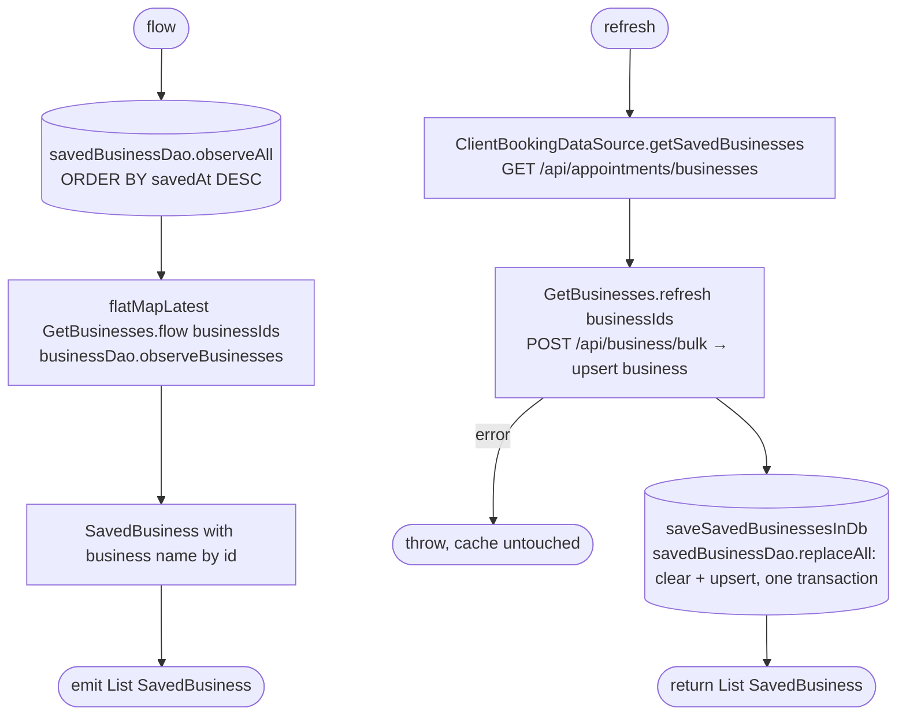

[← Operations](../README.md)

# Get saved businesses

`GetSavedBusinesses.flow()` / `.refresh()` → `GET /api/appointments/businesses` + [`GetBusinesses`](../business/get-businesses.md)
· called from `ClientHomeViewModel` (client web app Home in dashboard presentation, "Book again") and `SaveBusiness`

The route lists the businesses the caller saved (most recently saved first) with whether each takes appointments
now, when it was saved and the start of the caller's last `COMPLETED` appointment there (`null` when never
visited). `enabled` defaults to `false` and `lastVisitAt` to `null` when absent on the wire. The businesses
themselves are read with `GetBusinesses.refresh(ids)` (one bulk request, saved into `business`). A failed list or
business read fails the refresh before `saved_business` is written.

`saved_business` is replaced as a whole in one DAO transaction. `flow()` follows `saved_business` (by `savedAt`
descending) and, for its ids, the cached businesses; a business not cached yet has an empty name.

