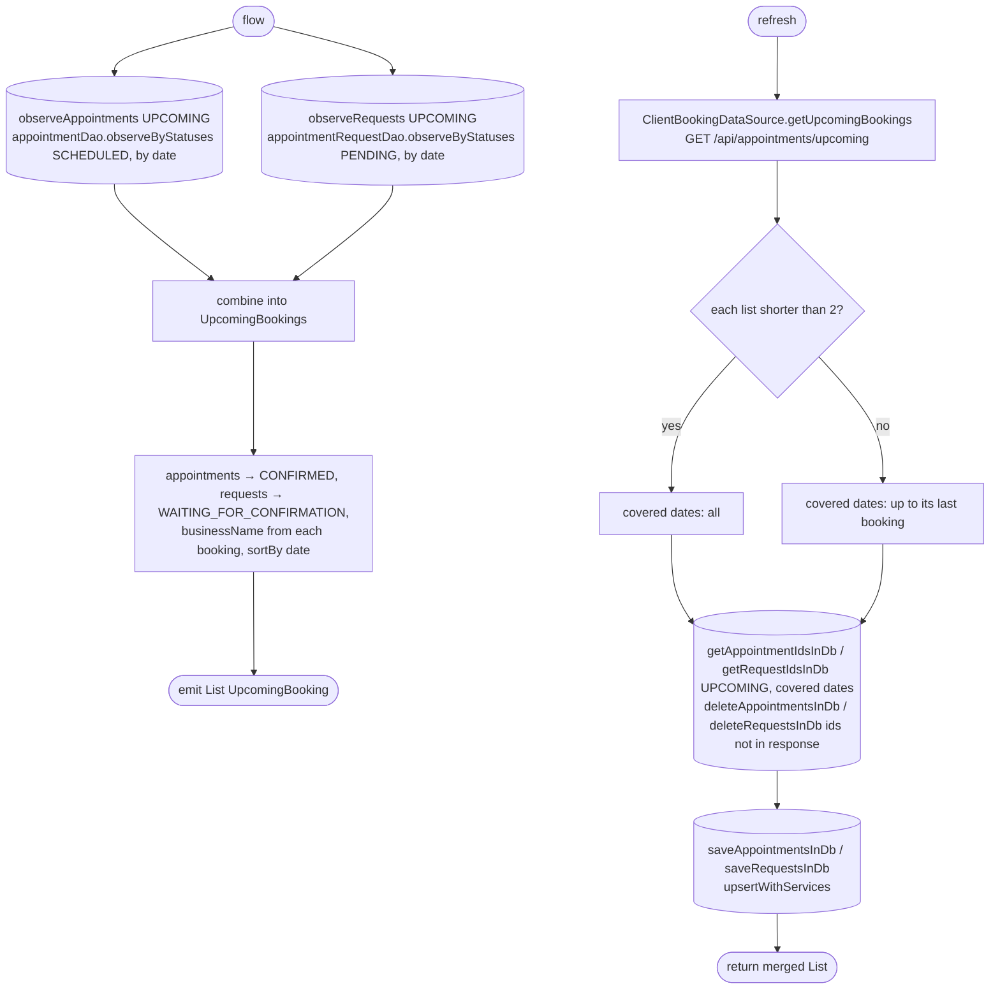

[← Operations](../README.md)

# Get upcoming bookings

`GetUpcomingBookings.flow()` / `.refresh()` → `GET /api/appointments/upcoming`
· called from `ClientHomeViewModel` (client web app Home in dashboard presentation, "Upcoming") and, for `refresh` after a sent request, booking's [Send booking request](../booking/send-booking-request.md)

Client-facing: the route returns the caller's 2 nearest `SCHEDULED` appointments that have not ended (client
linked to the caller) and 2 nearest `PENDING` requests that have not started (made by the caller), across every
business, with the business's own `note` blanked. Both lists may be absent on the wire (empty repeated fields),
so `UpcomingBookingsRemote` defaults them to empty. Each booking carries its business's current name
(`businessName`), so nothing else is fetched.

The bookings are cached in the shared `appointment` and `appointment_request` tables of `ClientDatabase`, which
on the web hold only the signed-in client's own bookings, and which [Get client bookings](get-client-bookings.md)
pages into as well. Saving replaces only the dates the response covers, so it keeps what the Bookings screen paged
in: a list shorter than the route's limit of 2 covers every date, and deletes every cached scheduled appointment
(or pending request) it does not contain; a full list covers dates up to its last booking, and deletes only the
missing ones up to then. `flow()` merges both tables: appointments become `CONFIRMED`, requests
`WAITING_FOR_CONFIRMATION` (request dates converted to the device time zone, as appointment dates already are),
soonest first, each with the business name it was stored with.

