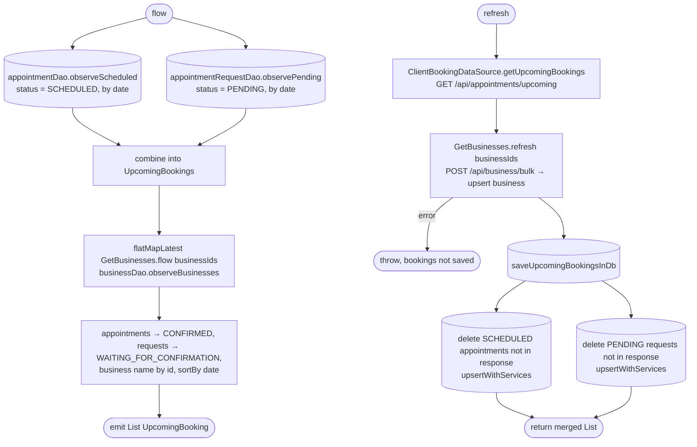

[← Operations](../README.md)

# Get upcoming bookings

`GetUpcomingBookings.flow()` / `.refresh()` → `GET /api/appointments/upcoming` + [`GetBusinesses`](../business/get-businesses.md)
· called from `ClientHomeViewModel` (client web app Home in dashboard presentation, "Upcoming") and, for `refresh` after a sent request, booking's [Send booking request](../booking/send-booking-request.md)

Client-facing: the route returns the caller's 2 nearest `SCHEDULED` appointments that have not ended (client
linked to the caller) and 2 nearest `PENDING` requests that have not started (made by the caller), across every
business, with the business's own `note` blanked. Both lists may be absent on the wire (empty repeated fields),
so `UpcomingBookingsRemote` defaults them to empty. The response carries business ids only, so `refresh()` reads
the booked businesses through `GetBusinesses.refresh(ids)` (one bulk request, saved into `business`) before saving
the bookings. A failed business read fails the refresh before the bookings are saved.

The bookings are cached in the shared `appointment` and `appointment_request` tables of `ClientDatabase`, which
on the web hold only the signed-in client's own bookings. Saving replaces the cached upcoming set: scheduled
appointments and pending requests the response no longer contains are deleted. `flow()` merges both tables and,
for their business ids, the cached businesses: appointments become `CONFIRMED`, requests
`WAITING_FOR_CONFIRMATION` (request dates converted to the device time zone, as appointment dates already are),
soonest first, named after their business (empty while it is not cached).

