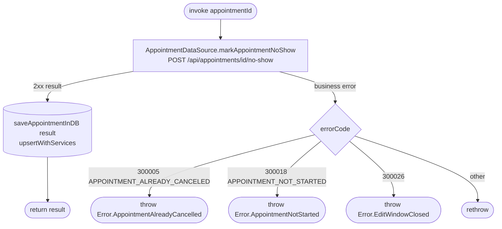

[← Operations](../README.md)

# Mark appointment as no-show

`MarkAppointmentNoShow(appointmentId)` → `POST /api/appointments/{id}/no-show`
· called from `AppointmentDetailsViewModel` (the "Client didn't show up" button, after a confirmation dialog)

Marks a **started** `SCHEDULED` or `COMPLETED` appointment as `NO_SHOW`. The backend treats an
appointment that is already `NO_SHOW` as a no-op. No request body.

The details screen shows the button only when `Appointment.canBeMarkedNoShow(now, timeZone)` is true: `SCHEDULED`
or `COMPLETED`, `date <= now`, and no more than `Appointment.EDIT_WINDOW` (seven days) after the scheduled end. The scheduled end
is the start plus all booked service durations; the exact edit-window cutoff is inclusive. The
ViewModel passes its injected clock's instant and the device time zone (the zone appointment dates are
mapped in) when rendering action visibility.

`EditWindowClosed` means the appointment ended more than seven days ago.

On this error, the details ViewModel shows a short error global message and calls
`GetAppointment.refresh(id)` to update the cached appointment and action visibility. No-show marking
is not retried, and refresh plays no success haptic.
