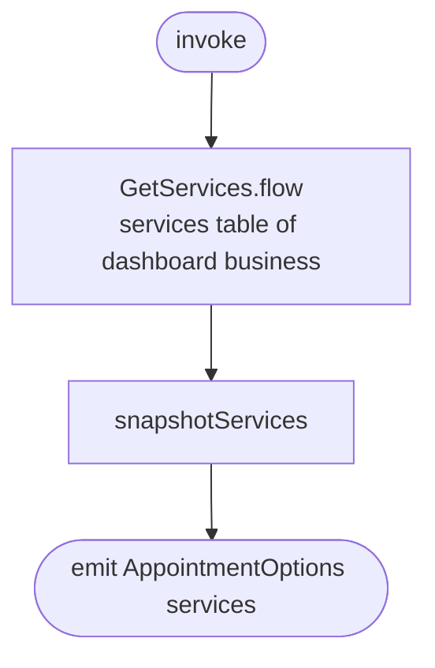

[← Operations](../README.md)

# Observe appointment options

`ObserveAppointmentOptions()` → `Flow<AppointmentOptions>`, **local only**
· called from `AppointmentCreateViewModel` and `AppointmentDetailsViewModel`

Feeds the service picker on the appointment forms with the cached services of the dashboard business and
re-emits whenever the table changes. That includes the refresh [Get appointment options](get-appointment-options.md)
runs on start, and services created while the form is open. No network calls.

Composes [Get services](../services/get-services.md).
