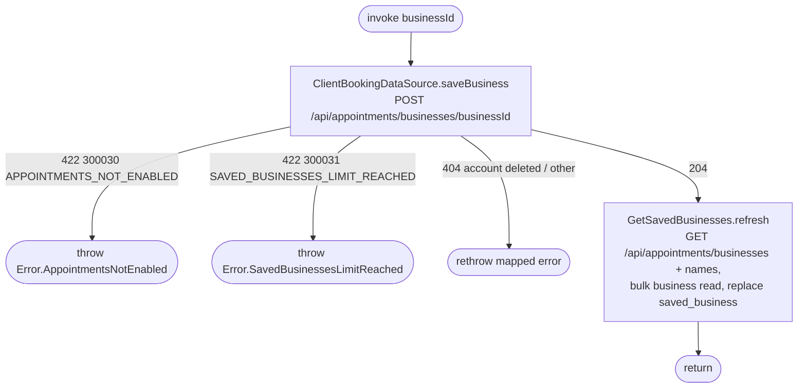

[← Operations](../README.md)

# Save business

`SaveBusiness(businessId)` → `POST /api/appointments/businesses/{businessId}`, then `GetSavedBusinesses.refresh()`
· called from `ClientHomeViewModel` when the Mini App is launched with a business id as its start parameter

Adds the business to the caller's saved businesses (saving one already saved changes nothing). The route returns
`204` without a body, so the use case refreshes the saved list to put the new row into `saved_business` and the
business into `business`; observers of `GetSavedBusinesses.flow()` update from there. A failure of that refresh is
thrown too, although the business was saved on the server.

