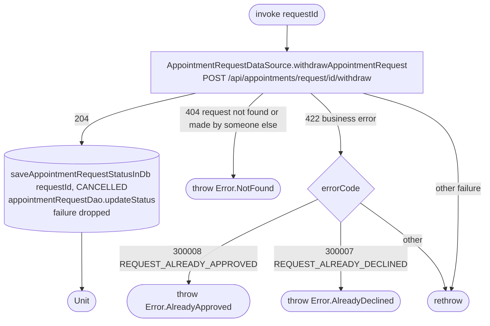

[← Operations](../README.md)

# Withdraw appointment request

`WithdrawAppointmentRequest(requestId)` → `POST /api/appointments/request/{id}/withdraw`
· called by booking's [Withdraw booking request](../booking/withdraw-booking-request.md); bound by
`clientAppointmentsDomainModule()` (client web app only)

Client-facing: withdraws a pending request the caller made. The backend sets it to `CANCELLED`, frees its place under
the business's limit of pending requests per client and does not notify the business. The route answers `204` with no
body. After the network call succeeds, the cached `appointment_request` row is set to `CANCELLED` in a separate
datasource call, as the backend now has it: [Get upcoming bookings](get-upcoming-bookings.md) (pending only) drops it
at once, and [Get client appointment request](get-client-appointment-request.md) keeps emitting it, now closed, so an
open request details screen does not go blank. That cache write is best effort: the request is withdrawn on the
backend either way, so its failure is dropped instead of reported. A failed network call leaves the cached row as it
is.

