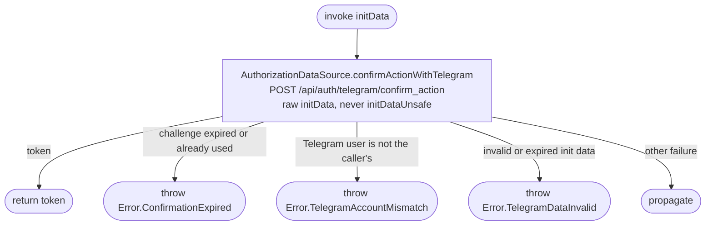

[← Operations](../README.md)

# Confirm action with Telegram

`ConfirmActionWithTelegram(initData)` exchanges the raw `Telegram.WebApp.initData` of a Mini App launched from
the bot's Confirm button for the same single-use action confirmation token a passkey gives. It is the second
half of [Start Telegram action confirmation](start-telegram-action-confirmation.md) and is called only by
[Complete Telegram confirmation](../settings/complete-telegram-confirmation.md).

The server takes the action, business and target from the stored challenge named by the signed
`start_param`, never from the request, so a confirmation started for an export can't become a deletion. The
token stays in memory and is never cached.

**Pending backend (nocturneproperties/bookkme#210):** the route is not in the swagger yet.
`CommonAuthorizationDataSource.confirmActionWithTelegram` is a `TODO` placeholder and the error codes are not
mapped yet (invalid or expired init data is expected to reuse sign-in's `TELEGRAM_DATA_INVALID` (14) and
`TELEGRAM_DATA_EXPIRED` (15)).
