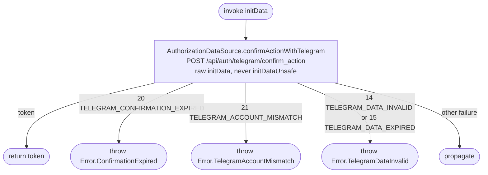

[← Operations](../README.md)

# Confirm action with Telegram

`ConfirmActionWithTelegram(initData)` exchanges the raw `Telegram.WebApp.initData` of a Mini App launched from
the bot's Confirm button for the same single-use action confirmation token a passkey gives. It is the second
half of [Start Telegram action confirmation](start-telegram-action-confirmation.md) and is called only by
[Complete Telegram confirmation](../settings/complete-telegram-confirmation.md).

The server takes the action, business and target from the stored challenge named by the signed
`start_param`, never from the request, so a confirmation started for an export can't become a deletion. The
token stays in memory and is never cached.

Request body `TelegramActionConfirmationRequestRemote`: `initData` (1); response `ActionConfirmationTokenRemote`, as
for the passkey route. The server spends the challenge only when every check passes, so a forwarded button doesn't
use it up. `TELEGRAM_CONFIRMATION_UNAVAILABLE` (25) propagates as `BusinessError` with the server's message.
