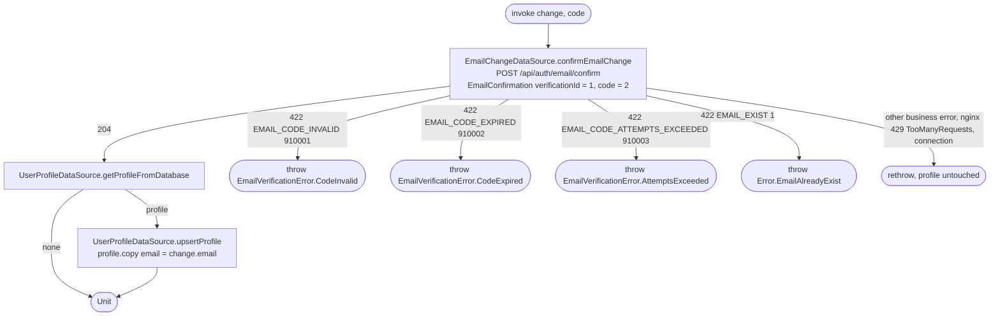

[← Operations](../README.md)

# Confirm email change

`ConfirmEmailChange(change, code)` → `POST /api/auth/email/confirm`
· called from `VerifyEmailViewModel` in email-change mode

Sends the verification id of the newest [Start email change](start-email-change.md) with the typed code.
On 204 the backend has stored the new address; the use case then writes the confirmed address into the
cached `user_profile` row, so Settings, Edit Profile and the dashboard observe it without another
request. It does not re-fetch `GET /api/user/me`: a network failure after a successful confirmation
would otherwise report a change that already happened as failed. Without a cached profile nothing is
written; the next `UserProfileCRUD.get()` loads it from the backend.

`EMAIL_EXIST` means another account took the address after the code was sent. The code stays usable on
the backend, so the verify screen keeps it and lets the user go back to pick another address.

