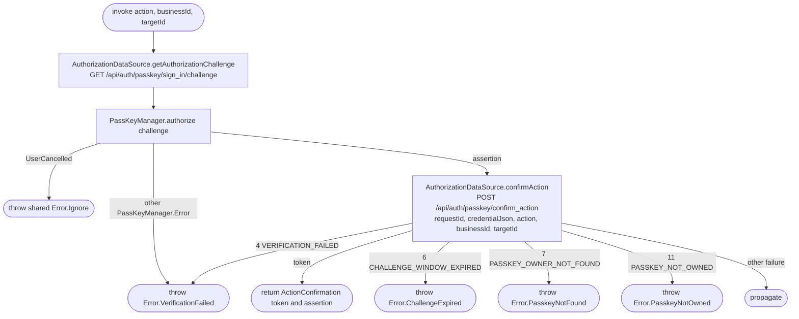

[← Operations](../README.md)

# Confirm sensitive action

`ConfirmSensitiveAction(action, businessId, targetId)` returns `ActionConfirmation`: a single-use token, valid for two minutes,
and the verified passkey assertion JSON needed for account-deletion credential cleanup. Both stay in
memory for the caller and are never cached. Callers bind it to the exact action, business and target they will submit.

Actions use the backend enum order: `DELETE_CLIENT`, `EXPORT_PERSONAL_DATA`, `EXPORT_BUSINESS_DATA`,
`DELETE_ACCOUNT`. Existing ordinals are unchanged; account deletion is appended.
Challenge/credential failures cannot reach the protected write. No automatic confirmation retry is made.

Account deletion confirms with a nil business UUID and the caller's user UUID as target. Exports and
client deletion consume only the returned token. Credential cleanup uses the original verified assertion
after successful deletion and does not trigger another passkey prompt. Unrelated errors propagate unchanged.
