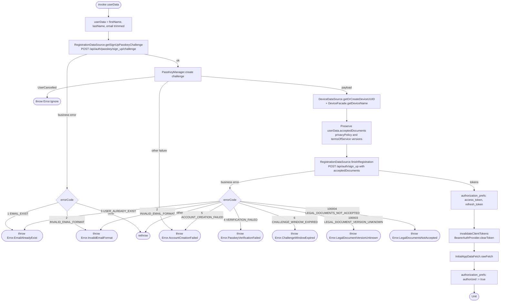

[← Operations](../README.md)

# Create account (passkey sign-up)

`CreateAccount(userData)` → `POST /api/auth/passkey/sign_up/challenge`, then `POST /api/auth/sign_up`
· called from `SignUpViewModel`

`UserData.acceptedDocuments` carries the exact privacy-policy and terms-of-service versions accepted
by the caller. These values are preserved unchanged through trimming and sent as required protobuf field 5;
inside that message `privacyPolicy` is field 1 and `termsOfService` is field 2. Null means not accepted.
The backend requires the versions in effect for all published documents (`GET /api/user/legal`). This use
case never fetches versions and never infers consent. Startup preloads the legal documents; signup reads
the persisted requirements through
[Get signup legal documents](get-sign-up-legal-documents.md), requires explicit acceptance of every
required document and passes both displayed versions. Missing terms of service or privacy policy prevents
signup from submitting. Legal rejections reload requirements and require renewed consent after a successful load
for review before another user-triggered attempt; no registration is retried automatically.
Consent is validated with the profile fields when confirm is clicked. Missing consent shows an error on
the checkbox and prevents account creation; changing the checkbox clears that error. Signup uses the
`create_account` launch key with `LaunchBehaviour.DropLatest` to drop concurrent creation attempts.

First name, last name and email are trimmed before anything is sent. A three-step WebAuthn registration: the server issues a challenge, the platform `PassKeyManager` creates the
credential, and the server verifies it and returns tokens. After the tokens are saved, the Ktor bearer cache
is invalidated so the next request loads the new tokens. Then `rawFetch()` runs. `authorized = true` is
written **last**. That flag is what `BootstrapViewModel` observes to navigate into the app, so the main screen
opens with the profile and business list already cached.

Composes [Initial app data fetch](initial-app-data-fetch.md). A failure inside `rawFetch()` (for example
`GET /api/user/me`) propagates **after** the tokens are saved but **before** `authorized = true` is written. The
account exists and the tokens are stored, yet the app stays on the login screen.
