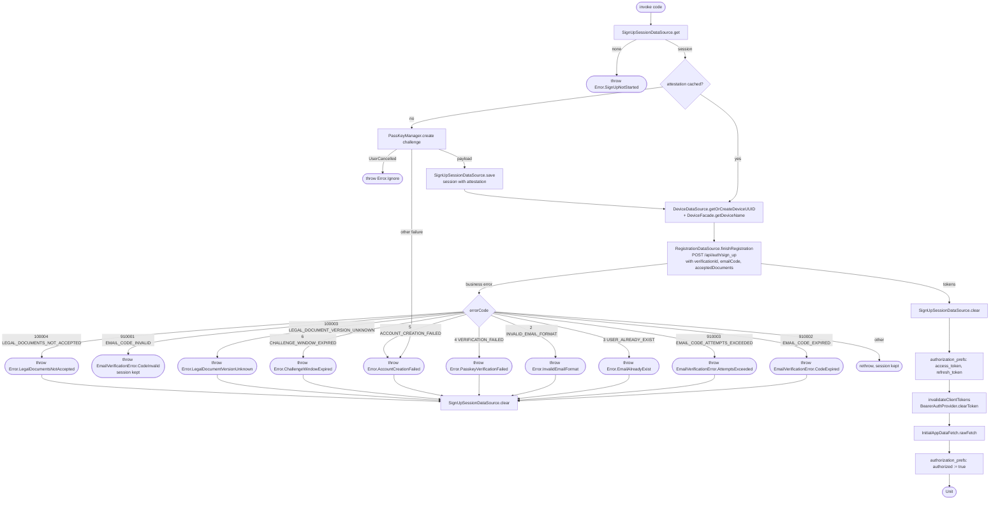

[← Operations](../README.md)

# Finish sign-up (passkey, code and account creation)

`FinishSignUp(code)` → `POST /api/auth/sign_up` · called from the verify-email flow after
[Start sign-up](start-sign-up.md)

Reads the session saved by `StartSignUp`; without one it throws `SignUpNotStarted`. On the first call for
a challenge the platform `PassKeyManager` creates the passkey and the attestation is stored in the
session, so every later call (for example after a wrong code) reuses it and needs **no second passkey
prompt**. The backend checks the code **before** the passkey and does not spend the challenge on a wrong
code, which is what makes the reuse safe. Starting sign-up again replaces the session, so a new challenge
gets a new passkey.

The session is dropped on every mapped failure except a wrong code: expired code, too many wrong codes,
expired challenge window, taken email, legal rejection, passkey verification failure and account creation
failure. The user then starts again, which also resends the code. Unmapped errors (connection, 5xx) keep
the session so the same code can be retried. A cancelled passkey prompt keeps the session without an
attestation.

A passkey created for a challenge that later expires stays on the device. `signalAccountDeleted` takes a
sign-in assertion, not a registration attestation, and the account never existed, so there is no cleanup
signal available. Known limitation.

`Accepted legal documents` are the versions captured at start. The backend requires the versions in effect
for all published documents (`GET /api/user/legal`); legal rejections reload the requirements and require
renewed consent before another user-triggered attempt. No registration is retried automatically.

After the tokens are saved, the Ktor bearer cache is invalidated so the next request loads the new
tokens. Then `rawFetch()` runs. `authorized = true` is written **last**. That flag is what
`BootstrapViewModel` observes to navigate into the app, so the main screen opens with the profile and
business list already cached.

Composes [Initial app data fetch](initial-app-data-fetch.md). A failure inside `rawFetch()` (for example
`GET /api/user/me`) propagates **after** the tokens are saved but **before** `authorized = true` is written.
The account exists and the tokens are stored, yet the app stays on the login screen.
