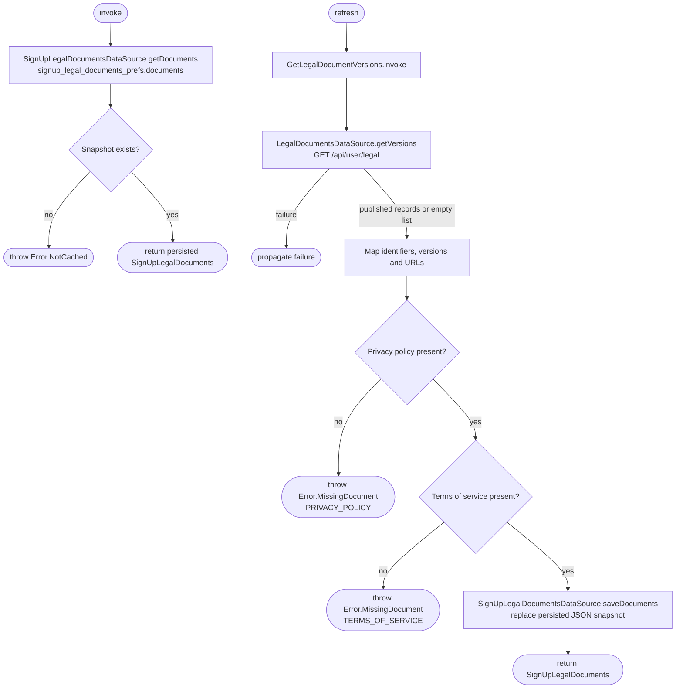

[← Operations](../README.md)

# Get signup legal documents

`GetSignUpLegalDocuments.invoke()` reads only the persisted signup document pair through
`SignUpLegalDocumentsDataSource.getDocuments()`. It decodes the `documents` JSON value in
`signup_legal_documents_prefs`; it never fetches from the network. An absent snapshot throws
`GetSignUpLegalDocuments.Error.NotCached`.
The snapshot survives both app restarts and logout. It contains public document metadata, not user consent,
and its datasource is intentionally not registered as a `LogOutAction`.

`GetSignUpLegalDocuments.refresh()` calls settings `GetLegalDocumentVersions()` →
`LegalDocumentsDataSource.getVersions()` → `GET /api/user/legal` using the existing public endpoint.
The authorization-owned wrapper maps document identifiers, version strings and links into
`SignUpLegalDocuments`, requiring both privacy policy and terms of service. Missing records, including an
empty response, throw `Error.MissingDocument` with the missing identifier; privacy policy is checked first.
Only a complete pair is saved. Remote or validation failures leave the previous snapshot unchanged.

`InitialAppDataFetch.timestampProtectedFetch()` preloads with `refresh()` before fetching the user profile.
Signup uses `invoke()` when it opens, on retry, and after legal-acceptance rejection. These are cache reads;
none refresh the remote documents. Cache reads use the `load_legal_documents` launch key with
`LaunchBehaviour.DropLatest` to drop duplicates.

Signup renders one unchecked checkbox for both required documents, with each document name as an inline
hyperlink in its label. Checking it explicitly accepts both displayed versions. Once documents load, confirm
is enabled until form validation reports an invalid field. Confirm validates consent alongside first name,
last name and email. Missing consent sets `legalAcceptance.validationState = ERROR`, `isValid = false`,
and a localized supporting message; account creation does not run. The checkbox remains enabled so the user
can correct it, and changing it clears its error like editing a text field. Consent errors do not show retry.
Opening either link does not imply acceptance. A failed load sets
`legalAcceptance.validationState = ERROR` and its `supportingTextRes`,
displays supporting text beneath the checkbox with retry, and keeps signup blocked. Starting a
retry starts `reloadLegalDocuments.isLoading` and disables submission while preserving the document pair,
consent and validation fields. Both platforms show only the loading indicator in place of the checkbox and
retry action while the request is in progress. A successful response replaces the document pair, unchecks
consent and clears the previous validation error. A failed response preserves the existing documents and
keeps submission disabled. `reloadLegalDocuments.isVisible` is true only after a document-loading failure;
it controls retry visibility and prevents submission until loading succeeds.
`SignUpState.legalDocuments` is a nullable `SignUpLegalDocumentsState` with named `privacyPolicy` and
`termsOfService` link states, assigned together after a successful load. It does not use `ListState`.

On `CreateAccount.Error.LegalDocumentVersionUnknown` (100003) or `LegalDocumentsNotAccepted` (100004), signup
explains that the documents changed and rereads the cached requirements. Previous documents and consent remain in
state while the loading indicator is shown; consent is unchecked when the replacement documents arrive.
The caller must explicitly accept the reloaded documents and submit again; registration is never retried
automatically. The checkbox remains enabled during loading, errors and submission. Its callback is installed
once in `setup()` and updates consent. The callback does not capture document versions; submission reads the
current document pair from screen state.
Document records live in screen state; no private document collection,
revision counter or error flag is stored. User-entered profile fields are preserved, and registration takes
an immutable snapshot of both profile and accepted versions before the passkey flow begins.
