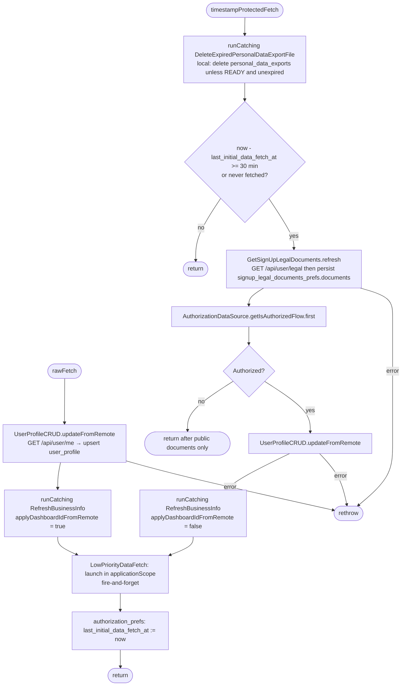
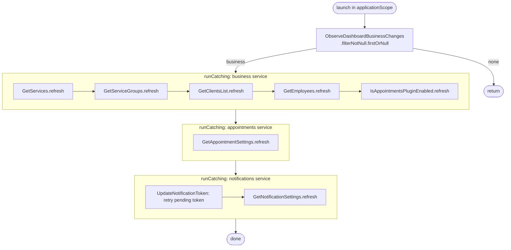

[← Operations](../README.md)

# Initial app data fetch (and low-priority data fetch)

`InitialAppDataFetch.rawFetch()` / `.timestampProtectedFetch()`
· `rawFetch` is called from [Sign in](sign-in.md) and [Create account](create-account.md).
`timestampProtectedFetch` is called from `BootstrapViewModel` on every app start.

It warms the cache so the first screens can render locally. The variants differ as follows:
`rawFetch` always runs and **adopts the server's dashboard business selection**.
`timestampProtectedFetch` first calls
[`DeleteExpiredPersonalDataExportFile`](../settings/delete-expired-personal-data-export-file.md) inside
`runCatching` on every call, before the throttle and authorization check. The fetch itself runs only
when at least 30 minutes have passed since
`authorization_prefs.last_initial_data_fetch_at`, and it keeps the local selection. When due, it first
calls `GetSignUpLegalDocuments.refresh()` to fetch and persist both public legal documents. It then reads
`AuthorizationDataSource.getIsAuthorizedFlow().first()`. If unauthorized, it returns immediately: no profile,
business or low-priority fetch is started, and no initial-data timestamp is saved. `rawFetch()` retains its
existing authenticated flow and does not preload legal documents.

Legal preloading and the profile fetch are not wrapped in `runCatching`. A failure propagates and the
initial-data timestamp is not written. Failed legal preloading prevents the private fetches from starting;
it does not overwrite an older complete legal-document snapshot.

## Low-priority data fetch

`LowPriorityDataFetch` (an internal class in `authorization/domain/impl`, not a public use case) runs in the
application scope, so it outlives the caller. It waits for the first non-null dashboard business and then
refreshes its data **one request after another**, which is intentional to avoid a burst of requests. The
requests are grouped by backend service so that one failing service does not block the others:

Within a group, the first failure skips the rest of that group. For example, if clients fail, employees and the
plugin flag are not refreshed on this run.
