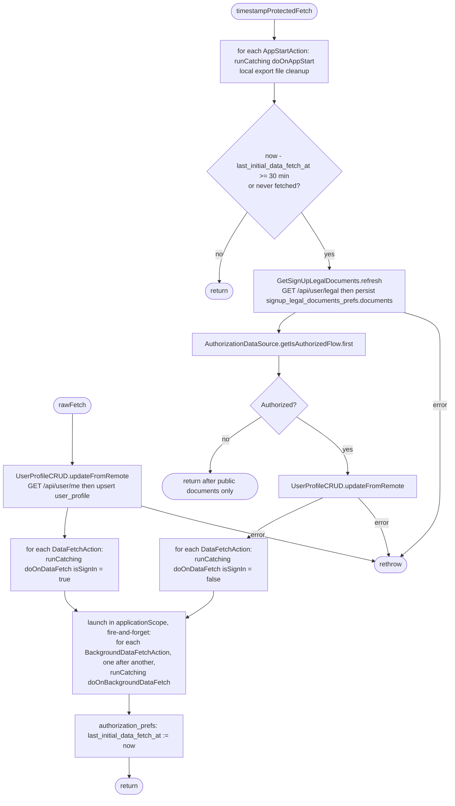
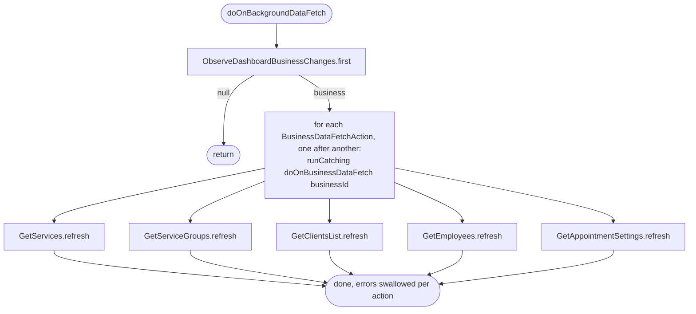

[← Operations](../README.md)

# Initial app data fetch (and background data fetch)

`InitialAppDataFetch.rawFetch()` / `.timestampProtectedFetch()`
· `rawFetch` is called from [Sign in](sign-in.md), [Sign in with Telegram](sign-in-with-telegram.md) and
[Finish sign-up](finish-sign-up.md). `timestampProtectedFetch` is called from `BootstrapViewModel` on every app start.

It warms the cache so the first screens can render locally. Like [Log out](log-out.md), it does not call other
features directly: features take part by implementing a trigger interface from `core:domain`
(`me.bookk.core.domain.fetch`) and binding it in their domain Koin module with
`binds arrayOf(<UseCase>::class, <Trigger>::class)`. `InitialAppDataFetchImpl` receives each trigger as a
`getAll()` list.

| Trigger | When it runs | Bound implementations |
|---|---|---|
| `AppStartAction.doOnAppStart()` | `timestampProtectedFetch` only, on every call, before the throttle and authorization check | [`DeleteExpiredPersonalDataExportFile`](../settings/delete-expired-personal-data-export-file.md), [`DeleteExpiredBusinessDataExportFiles`](../business/delete-expired-business-data-export-files.md) |
| `DataFetchAction.doOnDataFetch(isSignIn)` | Authorized, after the profile update; awaited by the caller | [`RefreshBusinessInfo`](../business/refresh-business-info.md) (`applyDashboardIdFromRemote = isSignIn`) |
| `BackgroundDataFetchAction.doOnBackgroundDataFetch()` | Launched in the application scope once every data fetch has finished | [`UpdateNotificationToken`](../settings/update-notification-token.md) (pending-token retry), [`GetNotificationSettings`](../settings/get-notification-settings.md), the business feature's `DashboardBusinessDataFetch` |
| `BusinessDataFetchAction.doOnBusinessDataFetch(businessId)` | Run by `DashboardBusinessDataFetch` for the current dashboard business | [`GetServices`](../services/get-services.md), [`GetServiceGroups`](../services/get-service-groups.md), [`GetClientsList`](../clients/get-clients-list.md), [`GetEmployees`](../employees/get-employees.md), [`GetAppointmentSettings`](../appointments/get-appointment-settings.md) |

`rawFetch` always runs and passes `isSignIn = true`, so the business refresh **adopts the server's dashboard
business selection**. `timestampProtectedFetch` passes `isSignIn = false` and keeps the local selection. It
fetches only when at least 30 minutes have passed since `authorization_prefs.last_initial_data_fetch_at`. When
due, it first calls `GetSignUpLegalDocuments.refresh()` to fetch and persist both public legal documents, then
reads `AuthorizationDataSource.getIsAuthorizedFlow().first()`. If unauthorized, it returns immediately: no profile,
data or background fetch is started, and no initial-data timestamp is saved. `rawFetch()` does not preload legal
documents and does not run app start actions.

Legal preloading and the profile fetch are not wrapped in `runCatching`. A failure propagates and the
initial-data timestamp is not written. Failed legal preloading prevents the private fetches from starting;
it does not overwrite an older complete legal-document snapshot. Every trigger action runs in its own
`runCatching`, so one failure never blocks the others. Actions of the same trigger run in Koin registration
order, which is not guaranteed; nothing depends on that order.

## Background data fetch

The background actions run in the application scope, so they outlive the caller, and **one request after
another**, which is intentional to avoid a burst of requests. They start only after every `DataFetchAction` has
finished, so the business refresh has already stored the dashboard business.

`DashboardBusinessDataFetch` (an internal class in `business/domain/impl`) reads the **current** dashboard
business and runs every `BusinessDataFetchAction` for it. It does not wait for a later one, because the
dashboard flow never completes and waiting would hold up the remaining background actions:

The appointments plugin flag is not part of this fetch: `RefreshBusinessInfo` already refreshes it for every
business during the data fetch.
