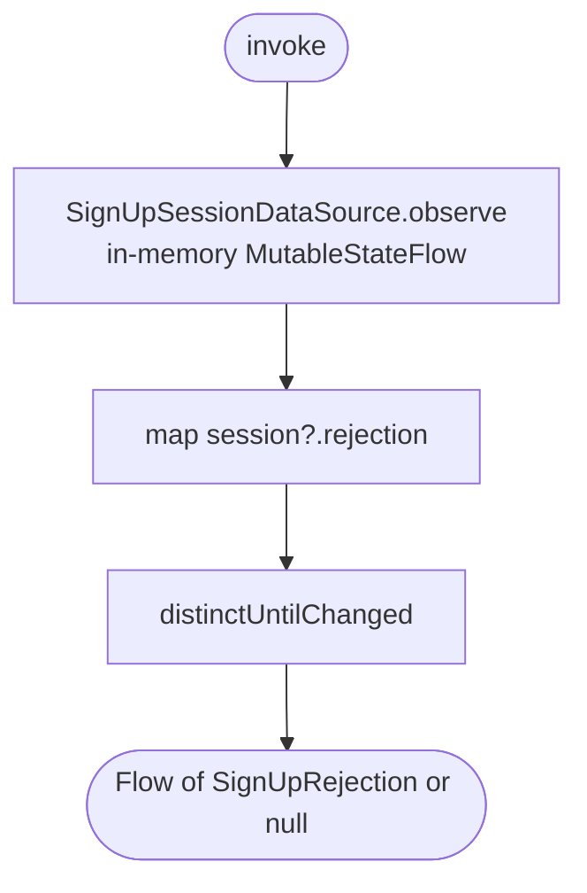

[← Operations](../README.md)

# Observe sign-up rejection

`ObserveSignUpRejection()` → `Flow<SignUpRejection?>` · local only (in-memory sign-up session) ·
observed by `SignUpViewModel` after its first successful [Start sign-up](start-sign-up.md)

The verify-email screen calls [Finish sign-up](finish-sign-up.md) and
[Resend sign-up code](resend-sign-up-code.md). When one of them fails with something only the sign-up form
can fix, the failure is stored as a `SignUpRejection` in the in-memory session and the verify-email screen
navigates back. The form renders the rejection from this flow:

| `SignUpRejection` | Stored by | Form reaction |
|---|---|---|
| `EMAIL_TAKEN` | Finish (3 `USER_ALREADY_EXIST`), Resend (`EmailAlreadyExist`) | email field error |
| `EMAIL_INVALID` | Finish (2 `INVALID_EMAIL_FORMAT`), Resend (`InvalidEmailFormat`) | email field error |
| `EMAIL_UNDELIVERABLE` | Resend (910005 `EMAIL_UNDELIVERABLE`) | email field error |
| `LEGAL_DOCUMENTS_CHANGED` | Finish (100003, 100004) | reload legal documents, require renewed consent |

The flow is state, not an event stream: it is the current session's rejection, `null` while the session
is active or absent. A new `StartSignUp` replaces the session and the flow returns to `null`. The form
starts observing only after its own start succeeded, so a rejection left by an abandoned earlier sign-up
is never shown on a freshly opened form.

