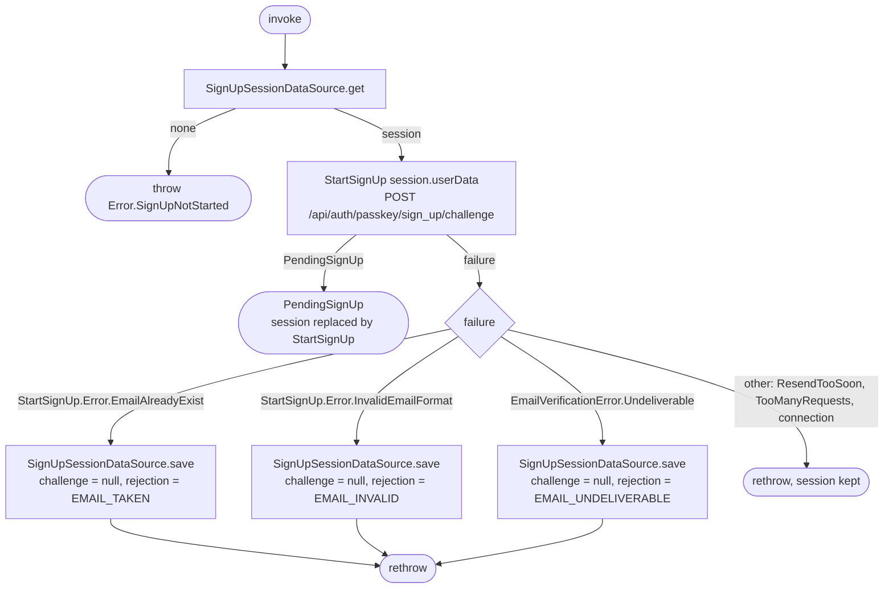

[← Operations](../README.md)

# Resend sign-up code

`ResendSignUpCode()` → `POST /api/auth/passkey/sign_up/challenge` (through [Start sign-up](start-sign-up.md))
· called from the verify-email screen's "Send a new code" action

Restarts sign-up with the user data kept in the in-memory sign-up session, so the verify-email screen
needs neither the form data nor navigation arguments. It works after
[Finish sign-up](finish-sign-up.md) dropped the challenge (expired code, too many wrong codes, expired
challenge window): dropping keeps the user data. Without any session (never started, or cleared by
logout) it throws `SignUpNotStarted`.

A successful restart replaces the session with a fresh challenge and no rejection, and the backend
emails a new code. When the backend refuses the address (taken, invalid format, undeliverable), the
session's challenge is dropped and the matching `SignUpRejection` is stored; the sign-up form observes it
through [Observe sign-up rejection](observe-sign-up-rejection.md) and marks the email field. A refused
resend that is only about timing (`ResendTooSoon`, nginx `TooManyRequests`) and connection failures keep
the session unchanged.

