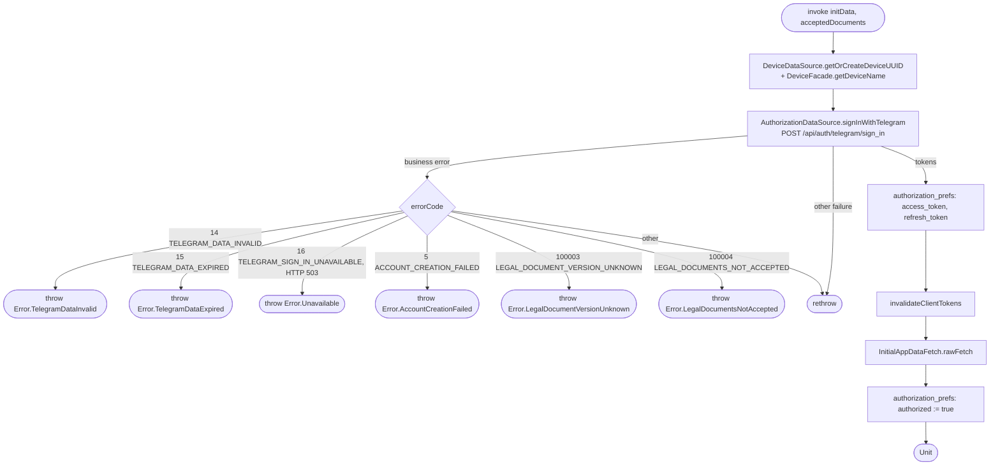

[← Operations](../README.md)

# Sign in with Telegram

`SignInWithTelegram(initData, acceptedDocuments)` → `POST /api/auth/telegram/sign_in`
· no caller yet (the website's `/telegram` Mini App needs the authorization data layer on JS first)

`initData` is the raw `Telegram.WebApp.initData` string, passed through unparsed: the server checks
Telegram's Ed25519 signature for its bot and accepts the data for one hour after `auth_date`. A
returning Telegram user signs in and the server ignores `acceptedDocuments`. A Telegram user seen for
the first time gets a new account with the placeholder email
`<telegram user id>@telegramundeliverable.org`. The first call sends `acceptedDocuments = null`, and
the caller sends the document versions in effect only after `LegalDocumentsNotAccepted`. After the
token step it follows [Sign in](sign-in.md): the same "`authorized` is written last" rule and the
same partial-failure behaviour.

