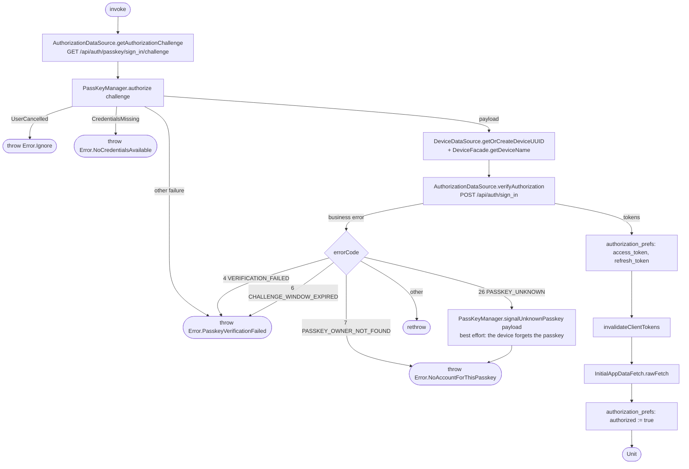

[← Operations](../README.md)

# Sign in (passkey)

`SignIn()` → `GET /api/auth/passkey/sign_in/challenge`, then `POST /api/auth/sign_in`
· called from `SignInViewModel`

It follows the same steps as [Finish sign-up](finish-sign-up.md) after the passkey step, and shares its
"`authorized` is written last" rule and its partial-failure behaviour.

`PASSKEY_UNKNOWN` (26) means no account has the passkey any more (deleted from the account or by the
backend). The device's passkey provider is told to forget it (`reportUnknownCredential` on Android's Credential
Manager and iOS 26's `ASCredentialUpdater`), so it stops being offered; a failure of that signal is ignored.
