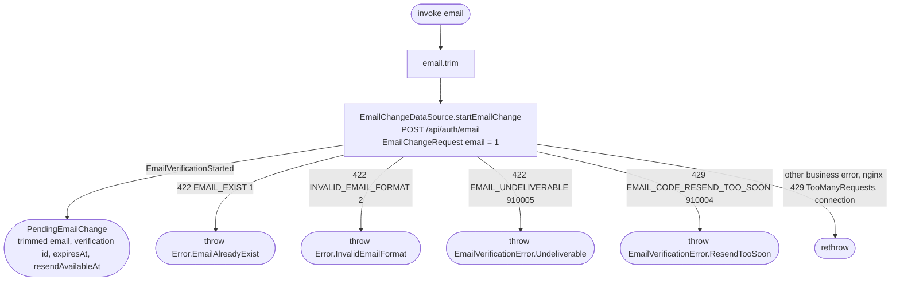

[← Operations](../README.md)

# Start email change

`StartEmailChange(email)` → `POST /api/auth/email`
· called from `ChangeEmailViewModel` ("Send code") and from `VerifyEmailViewModel` in email-change mode
("Send a new code")

Trims the address and asks the backend to email a 6-digit code (valid for 10 minutes) to it. The address
is not stored until the code is confirmed with [Confirm email change](confirm-email-change.md). Calling it
again for the same address is the resend: the backend starts a new verification and only the newest code
works. Nothing is cached locally; the returned `PendingEmailChange` (address + verification id and times)
is passed to the verify screen as its navigation argument.

