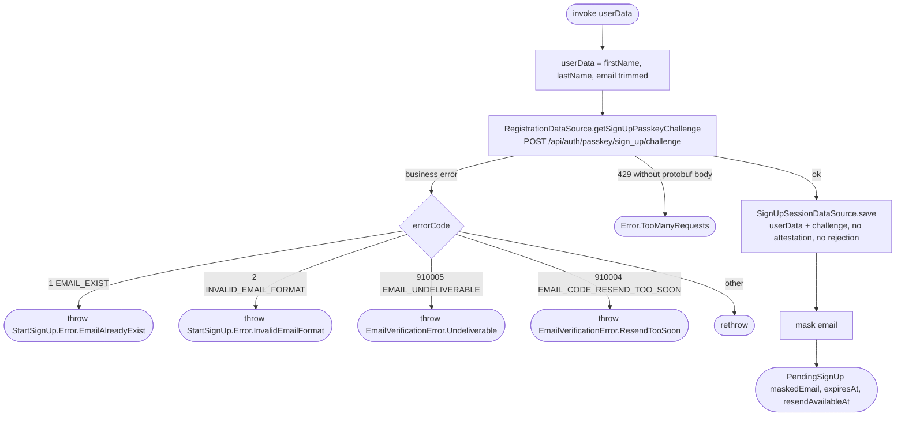

[← Operations](../README.md)

# Start sign-up (challenge and email code)

`StartSignUp(userData)` → `POST /api/auth/passkey/sign_up/challenge` · called from `SignUpViewModel`
and, to resend the code, through [Resend sign-up code](resend-sign-up-code.md) from the verify-email
screen

The challenge request has two side effects on the backend: it issues the passkey challenge (valid 10
minutes) and emails a 6-digit code in the `Accept-Language` language. Calling it again restarts sign-up
with a new challenge **and** a new code; only the newest code works.

First name, last name and email are trimmed before anything is sent. `UserData.acceptedDocuments` is
preserved unchanged and kept in the session so [Finish sign-up](finish-sign-up.md) can send it. Legal
requirements come from [Get signup legal documents](get-sign-up-legal-documents.md); this use case never
fetches versions and never infers consent.

The result carries the masked address (`j***@example.com`), `expiresAt` and `resendAvailableAt`. The
session (user data, challenge, verification id) lives in `SignUpSessionDataSource`, an in-memory `single`
that is never persisted: it holds a short-lived secret and process death simply restarts sign-up. It is
replaced on every successful start (which also clears any stored `SignUpRejection`), left untouched
when the challenge fails, and cleared on logout (`LogOutAction`).

