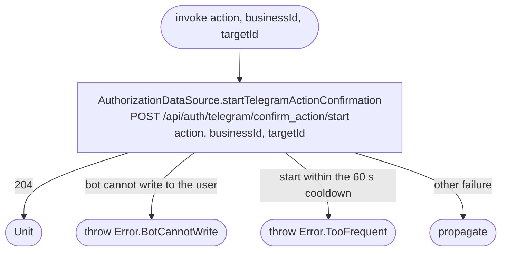

[← Operations](../README.md)

# Start Telegram action confirmation

`StartTelegramActionConfirmation(action, businessId, targetId)` asks the server to send the caller a
confirmation in their Telegram chat. It is the first half of the Mini App's confirmation, used instead of
[Confirm sensitive action](confirm-sensitive-action.md) because Telegram's in-app browser has no passkeys.
Only the settings Mini App bindings call it, through `TelegramConfirmationSender` (see
[Delete account](../settings/delete-account.md) and [Start personal data export](../settings/start-personal-data-export.md)).

The server keeps a five-minute challenge and its bot sends a message with a Confirm button that reopens the
Mini App with `start_param` `op_<kind>_<32 hex>` (`delete-account` or `export-personal`). Nothing is stored on
the device. Only `DELETE_ACCOUNT` and `EXPORT_PERSONAL_DATA` with the nil business id and the caller as
target are accepted.

**Pending backend (nocturneproperties/bookkme#210):** the route is not in the swagger yet.
`CommonAuthorizationDataSource.startTelegramActionConfirmation` is a `TODO` placeholder, and the backend error
codes for "bot can't write" and "too frequent" are not mapped to `Error.BotCannotWrite` and `Error.TooFrequent`
yet, so today every call fails with `NotImplementedError`.
