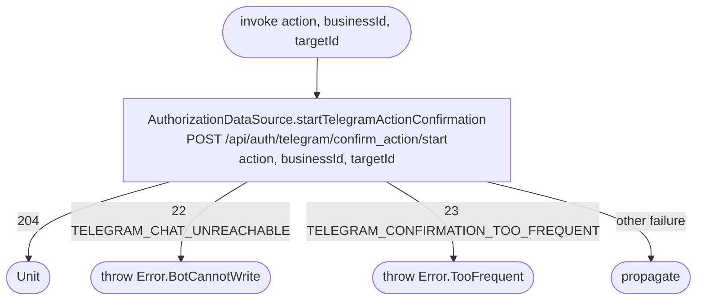

[← Operations](../README.md)

# Start Telegram action confirmation

`StartTelegramActionConfirmation(action, businessId, targetId)` asks the server to send the caller a
confirmation in their Telegram chat. It is the first half of the Mini App's confirmation, used instead of
[Confirm sensitive action](confirm-sensitive-action.md) because Telegram's in-app browser has no passkeys.
Only the settings Mini App bindings call it, through `TelegramConfirmationSender` (see
[Request account deletion](../settings/request-account-deletion.md) and [Start personal data export](../settings/start-personal-data-export.md)).

The server keeps a five-minute challenge and its bot sends a message with a Confirm button that reopens the
Mini App with `start_param` `op_<kind>_<32 hex>` (`delete-account` or `export-personal`). Nothing is stored on
the device. Only `DELETE_ACCOUNT` and `EXPORT_PERSONAL_DATA` with the nil business id and the caller as
target are accepted.

Request body `TelegramActionConfirmationStartRemote`: `action` (1, `SensitiveActionRemote` ordinal), `businessId` (2),
`targetId` (3). Other server errors (`TELEGRAM_IDENTITY_MISSING` (19), `ACTION_NOT_CONFIRMABLE_THROUGH_TELEGRAM` (24),
`TELEGRAM_CONFIRMATION_UNAVAILABLE` (25, also a failed send or a chat notifications hasn't stored yet)) propagate
as `BusinessError`, and the screen shows the server's message.
