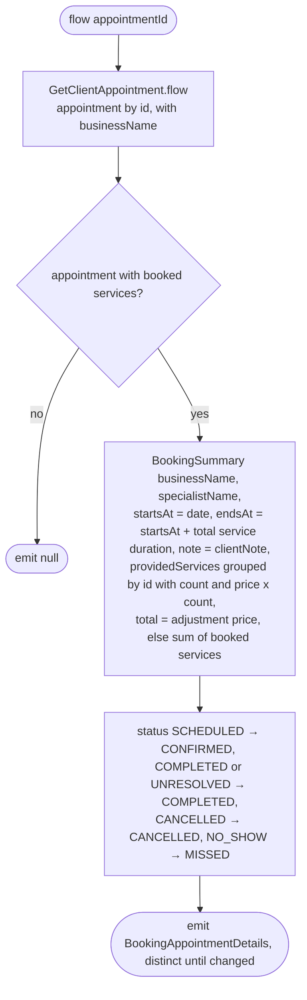

[← Operations](../README.md)

# Get booking appointment details

`GetBookingAppointmentDetails.flow(appointmentId)` → appointments' [Get client
appointment](../appointments/get-client-appointment.md) (local only: Room `appointment` by id, with its
`businessName`)
· called by `BookingAppointmentDetailsViewModel`, the appointment details screen of the client web app; bound by
`bookingDomainModule()`

Maps the cached appointment into the same `BookingSummary` as [Get booking request
details](get-booking-request-details.md), with the client's note taken from `clientNote` (the client-facing routes
blank the business's own `note`). The rows are the services the business provided (`providedServices`: the price
adjustment's services when it has any, else the booked ones) and the total is what it charged (the adjustment's price,
else the booked services' sum); the end still follows the booked services' duration. Its status
is `CONFIRMED` (`SCHEDULED`), `COMPLETED` (`COMPLETED` or `UNRESOLVED`, a past visit the business has not marked yet),
`CANCELLED` or `MISSED` (`NO_SHOW`). It emits `null` while the appointment is not cached, and for a cached appointment without booked services (the backend
never creates one); the screen then goes back.

