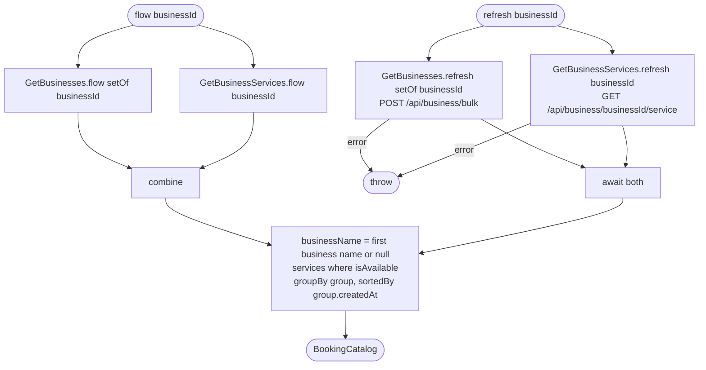

[← Operations](../README.md)

# Get booking catalog

`GetBookingCatalog.flow(businessId)` / `.refresh(businessId)` → via [Get businesses](../business/get-businesses.md)
and [Get business services](../services/get-business-services.md) · called from `BookingServicesViewModel` (the client
web app's services step); bound by `bookingDomainModule()`

What a client can book at one business: its name and the services it offers, as booking's own entities
(`BookingCatalog`, `BookingServiceGroup`, `BookingService`), so booking presentation depends on no other feature's
domain. Unavailable services are left out, groups that end up empty disappear, groups are ordered by creation and
services keep the order `GetBusinessServices` gives them. `flow` combines the two cached reads and emits a `null`
name while the business is not cached; `refresh` refreshes both in parallel and fails when either fails.

