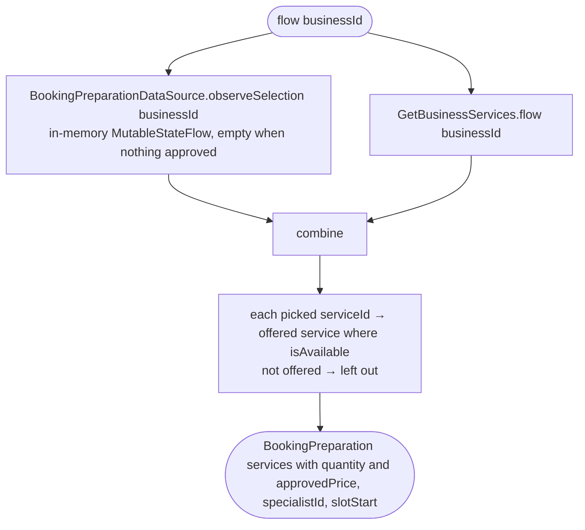

[← Operations](../README.md)

# Get booking preparation

`GetBookingPreparation.flow(businessId)` → local only (`BookingPreparationDataSource`, in memory) and
[Get business services](../services/get-business-services.md) `flow` · called from `BookingServicesViewModel`,
`BookingSpecialistViewModel` and `BookingDateTimeViewModel`;
bound by `bookingDomainModule()`

The booking a client is putting together at one business: the services they approved with Continue
([Set booking services](set-booking-services.md)) and how many of each, in that order, the specialist they picked ([Set booking specialist](set-booking-specialist.md)) and the start of the time they picked ([Set booking slot](set-booking-slot.md)), if any. Picks
not yet approved stay on
the screen and never reach it. `InMemoryBookingPreparationDataSource`, the one datasource behind every booking step, is a `single`
holding one `BookingSelection` per business id in a `MutableStateFlow`, so the approved services outlive the screens: opening the business again
restores them, and later steps read them from here. Nothing is persisted; they last until the page reloads or the
user logs out (the datasource is a `LogOutAction`). Each pick is matched against the business's
current services, so the emitted service carries the current name, duration and price, and a pick the business no
longer offers (deleted or unavailable) is left out. Each prepared service also carries the `approvedPrice` it was
picked at; when the cached services were refreshed with a new price since (e.g. by
[Send booking request](send-booking-request.md)), the two differ and the Review step shows both.

