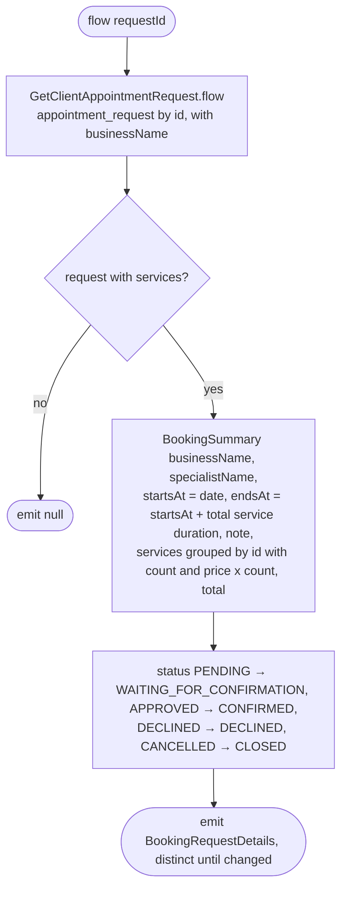

[← Operations](../README.md)

# Get booking request details

`GetBookingRequestDetails.flow(requestId)` → appointments' [Get client appointment
request](../appointments/get-client-appointment-request.md) (local only: Room `appointment_request` by id, named
through `business`)
· called by `BookingRequestDetailsViewModel`, the request details screen of the client web app; bound by
`bookingDomainModule()`

Maps the cached request into a `BookingSummary` (shared with [Get booking appointment
details](get-booking-appointment-details.md)): the business name, the specialist's full name, the start and the end
(the start plus the services' total duration, both in the device's time zone), the client's `note`, the services
grouped by id with their count and the summed price of each line, and the total of every booked service. Its status is
`WAITING_FOR_CONFIRMATION` (`PENDING`), `CONFIRMED` (`APPROVED`), `DECLINED` or `CLOSED` (`CANCELLED`: the backend uses
it both for a withdrawn request and for one nobody answered before its time, so the two can't be told apart). It emits
`null` while the request is not cached, and for a cached request without services (the backend never creates one,
and there would be no currency to total in); the screen then goes back.

