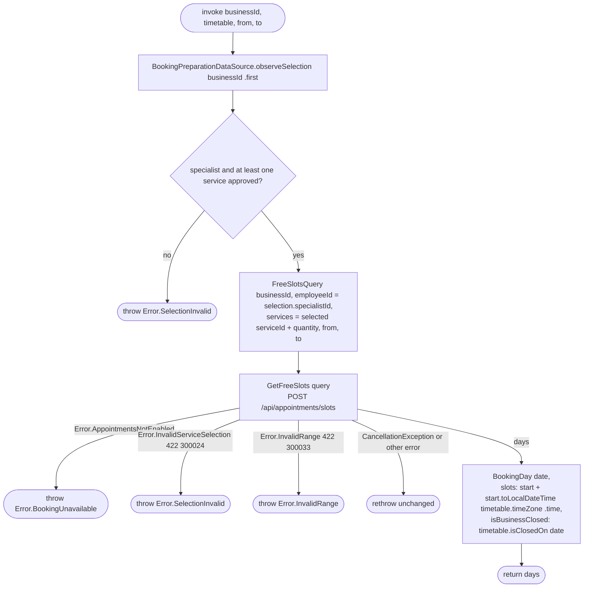

[← Operations](../README.md)

# Get booking slots

`GetBookingSlots(businessId, timetable, from, to)` → appointments' [Get free slots](../appointments/get-free-slots.md)
(`POST /api/appointments/slots`) · called by `BookingDateTimeViewModel` for the week the step shows; bound by
`bookingDomainModule()`

Reads the services (with counts) and the specialist the client approved from the business's in-memory
[booking preparation](get-booking-preparation.md) and asks for their free slots on each date of the range. When no
specialist or no service is approved (the preparation was cleared), it throws `Error.SelectionInvalid` without asking
the backend, and `BookingDateTimeViewModel` leaves the booking flow. Each slot gets its local time in the time zone of
the [booking timetable](get-booking-timetable.md) the caller already observes, and each day is marked when the
timetable says the business is closed on it (an inactive weekday or a day off), so the step can strike closed days
through while fully booked days stay tappable. The business is not looked up again; the slots themselves always come
from the backend.

