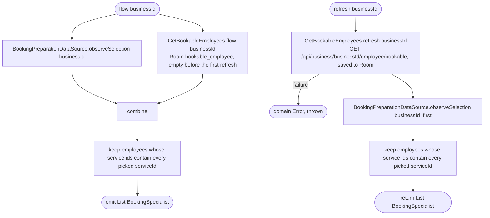

[← Operations](../README.md)

# Get booking specialists

`GetBookingSpecialists.flow(businessId)` / `.refresh(businessId)` → wraps
[Get bookable employees](../employees/get-bookable-employees.md): `flow` local only (its Room-cached `flow` and
`BookingPreparationDataSource`, in memory), `refresh` via its `refresh` (`GET /api/business/{businessId}/employee/bookable`)
· called from `BookingSpecialistViewModel`; bound by `bookingDomainModule()`

The people a client can book at a business: the bookable (not suspended) employees who provide every service in the
business's [booking preparation](get-booking-preparation.md), whatever their counts, in the backend's order. The
employees come from employees' `bookable_employee` cache, so coming back to the step, or opening it again after a
reload, shows the list at once while it refreshes. `flow` filters the cached employees against the approved services
and follows both; `refresh` fetches and saves the employees through `GetBookableEmployees.refresh` and returns them
filtered the same way. Before the first refresh the cache is empty and `flow` emits an empty list.

